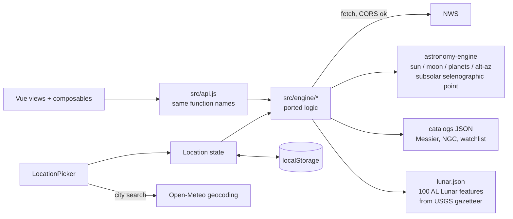

# Client-Side Port — Requirements & Plan

Status: **Phase 0 done** (fixtures in `tests/fixtures/`, `src/engine/lunar.js` `subsolarPoint`; measured error vs Horizons 0.004°, AE vs skyfield sun/moon alt/az 0.0015°; tests assert 0.01°). **Phase 1 done** (`src/engine/nws.js` `resolvePoint`, `src/composables/useLocation.js`; no picker UI until Phase 5; user locations get `elevationM` from the gridpoint in Phase 2; until Phase 2 the header shows the chosen location while data still comes from the server). **Phase 2 done** (`src/engine/{time,rating,astro,forecast,outlook}.js`; parity with astro-cli responses on saved Big Bend NWS payloads: twilight ±2 min, alt ±0.15°; live NWS works from the browser with no User-Agent issue; `fmtTime` now shows the site's wall clock from the ISO offset; NWS day durations like `P1DT6H` are expanded, unlike astro-cli; no separate `nights.js`/`schemas.js`, builders return the camelCase shapes directly). **Phase 3 done** (`src/engine/{scoring,tonight}.js`, `catalogs.json`, `fetchObservation` in `nws.js`; parity with astro-cli on the 2026-10-03 Big Bend night in window and instant mode: score ±0.5, alt ±0.2°, best time and window ±15 min; deliberate differences: the Moon note says Waxing/Waning from `MoonPhase` (astro-cli says Waxing for both), instant mode reports `moonInterference`, current conditions load even if the hourly forecast fails; `tonight` still rolls to tomorrow's 21:00–05:00 window after 21:00, as astro-cli does; one full plan takes ~20 ms in the browser, so no Web Worker; `fetchTonight`/`useTonight` take the location; `/api` is now used only by discover until Phase 4). **Phase 4 done** (`src/engine/lunar.js` `buildLunar`, `lunar.json`, `LunarView`, `useLunar`, `fetchLunar`; `discover` and its server call removed, so `/api` and the Vite proxy are unused until Phase 6; `lunar.json` has 108 AL checklist rows built once from the USGS gazetteer: 91 with places (86 matched by name, 5 resolved by hand), 17 phase-based rows with no place; score = relief(Sun altitude at the feature) × Moon-altitude weight, listed at ≥25 with the Moon ≥10° up in tonight's 21:00–05:00 window, phase rows fixed at 50; libration ignored; one plan takes ~5–12 ms). Implement directly on the current branch, `logic-port` (no new branch or worktree). The worktree rule in the global `CLAUDE.md` applies to work under `~/Dev/git/`, not personal projects under `~/Programming/`.

## 1. Goal

Make `astro-dashboard` fully self-contained: all computation happens in the browser and the app deploys as static files (portfolio subdomain, no server to run or secure). `astro-cli` stays untouched and is used locally for CLI work. The two codebases will drift; that is accepted and mitigated with shared test fixtures (section 6).

Visitors can set their own US location, saved in `localStorage`. The default is a **public demo location**, never the owner's home coordinates.

## 2. Why this approach (decisions already made)

- The risk in publishing was running a public server (abuse, upstream load, caches, error leakage, home coordinates). With no server, those risks disappear: NWS sees each visitor's own IP, and a visitor's location never reaches a server we run.
- Model: a static site of small tools, like `tools.simonwillison.net` (static pages on GitHub Pages).
- Rejected: a full multi-user platform; a desktop app; porting to Rust/WASM (no speed need, extra toolchain, still duplicates logic); Pyodide (code reuse, but a 25–40 MB first load; never tested here). Pyodide is the fallback if the JS port proves too costly.
- Supersedes `astro-cli/LOCATION_PLAN.md` (server-side `lat`/`lon`, caches, rate limiting), which no longer applies.

## 3. Verified facts

| Fact | Evidence |
|---|---|
| NWS sends `access-control-allow-origin: *` (`/points`, `/gridpoints`) | curl, 2026-10-02 |
| AAVSO VSX `api.list` sends `access-control-allow-origin: *` | curl, same date |
| Dashboard fetches `/api/{tonight,forecast,outlook,discover}` through four near-identical functions in `src/api.js`; composables call those and expose `{data, loading, error, load}`. `discover` is also used by the home card (`OverviewView`), the dock, and `App.vue`; tests touching it: `DiscoverView`, `OverviewView`, `App`, `AppDock` | `src/api.js`, `src/composables/*`, `grep -i discover` |
| The AL Lunar checklist (v20250811) lists 100 features: 18 eyes-only, 46 binocular, 36 telescope. It gives **no coordinates or phase windows**, only "~4/7/10/14 days old" crater groups and "research the best times" for 16 telescope features | `pdftotext` on the PDF (it is a spreadsheet saved as PDF; WebFetch cannot read it) |
| USGS/IAU Gazetteer has a downloadable Moon shapefile (9,087 features; center lat/lon, east-positive 0–360; diameter). 89 of the 100 checklist names matched by name search | `MOON_nomenclature_center_pts.zip` from planetarynames.wr.usgs.gov (GIS Downloads), 2026-10-02 |
| `astronomy-engine` has `RotationAxis(Moon)`; a prototype of the subsolar selenographic point gave colongitude new 265°, first quarter 3°, full 94°, last quarter 178° (ideal 270/0/90/180). Not yet checked against a published ephemeris. Bundle 116 KB min / 47 KB gzip | scratchpad prototype, 2026-10-02 |
| Vite dev proxies `/api` → `127.0.0.1:8000`; no CORS handling exists | `vite.config.js` |
| Response shapes are the camelCase dicts built in `astro-cli/astro_cli/schemas.py`; every response carries `generatedAt`, `location`, `errors[]` | `astro-cli/astro_cli/api.py`, `schemas.py` |
| Dashboard is ~1.4k lines of source with ~2k lines of vitest tests (tests mock the API shapes) | `wc -l` |
| Shared rater is a pure 108-line function (cloud, precip, wind, temp → score → 6 tiers) | `astro-cli/astro_cli/rating.py` |
| Catalogs are small local YAML: 110 Messier, 40 NGC, 2-entry watchlist | `astro-cli/data/*.yaml` |
| Python golden values for ephemeris already exist | `astro-cli/tests/test_ephemeris_golden.py` |

## 4. Requirements

### Functional
- **F1** All views (Overview/tonight, forecast, outlook, lunar) work with no backend. The **lunar** view replaces `discover` (variable-star discovery is dropped, not ported).
- **F2** The new code returns the **same JSON shapes** the dashboard already consumes. Keep the `fetchTonight/Forecast/Outlook` names and option objects so composables and components change minimally. `fetchDiscover`/`useDiscover` are replaced by `fetchLunar`/`useLunar` (new shape, no backend counterpart).
- **F8** Lunar: for the chosen location and night, rank the Astronomical League Lunar Observing Program features (100: 18 eyes-only, 46 binocular, 36 telescope) by how well they are placed tonight (Sun altitude at the feature, i.e. terminator proximity; Moon altitude during the night window), grouped by eyes-only / binocular / telescope with a filter by instrument tier (all, eyes-only, binoculars, telescope; default all), each with a one-line reason (e.g. "terminator, Sun 8°"). Show a clear empty state when the Moon is down or near new.
- **F9** The home page "fresh discoveries" card becomes a "lunar highlight" card (top feature tonight); the dock item `discover` becomes `lunar`.
- **F3** Upstream failures degrade the way the server did: a section becomes `null` and a message goes into `errors[]`; the page does not fail.
- **F4** Location: a bundled demo constant by default; the user can replace it with manual lat/lon, browser geolocation, or city search; one saved location per browser (`localStorage`), with a reset-to-demo control.
- **F5** Timezone, place name and elevation come from NWS `/points` (and gridpoint) for the chosen coordinates, as in the Python app.
- **F6** US only: coordinates NWS doesn't cover get a clear message.
- **F7** Static build deployable to a subdomain; the `/api` proxy and server-fetch code are removed once the port replaces them.

### Non-functional
- **N1** Coordinates are rounded to 2 decimals (~1 km) in the browser before storing or using.
- **N2** `localStorage` access is wrapped in try/catch; missing or corrupt values fall back to the demo location.
- **N3** Third-party place names (geocoder, NWS) render as text only, never `v-html`.
- **N4** Computation must not block the UI noticeably (measure before adding a Web Worker).
- **N5** Tests stay network-free (mock `fetch`).

## 5. Non-goals
- Any server, accounts, cross-device sync, multiple saved locations.
- Non-US weather.
- Per-user equipment; targets are still ranked for an 8" Dobsonian and a Dwarf Mini, and the UI says so in one line.
- Changing `astro-cli`, or sharing code between the repos. The lunar feature has no CLI counterpart.
- Variable-star discovery (AAVSO VSX/VSP): dropped with the `discover` view, not ported.
- An observation log, "mark as observed" state, or Astronomical League certificate submission. Without it the lunar view is a nightly suggester only; add later if wanted.
- Libration-aware ranking of limb features (Crisium, Grimaldi, Humorum, Petavius, Langrenus); `Libration()` makes it possible later.
- Offline/PWA, light pollution, horizon obstruction profiles.

## 6. Design

### Port map

| Python (lines) | JS target | Notes |
|---|---|---|
| `rating.py` (108) | `engine/rating.js` | pure; first to port; exact parity expected |
| `nights.py` (38) | `engine/nights.js` | night-window date logic; needs timezone arithmetic |
| `twilight.py` (141), `moonlight.py` (53), `ephemeris.py` (156) | `engine/astro.js` | wrap `astronomy-engine`; skyfield/DE421 vs AE differ slightly, so tests need tolerances |
| `weather.py` (475) | `engine/nws.js` | fetch + series expansion (ISO-duration), text-derived cloud, night summary |
| `forecast.py` (450) | `engine/forecast.js` | hourly conditions |
| `outlook.py` (267) | `engine/outlook.js` | per-night rows |
| `scoring.py` (461), `catalogs.py` (82) | `engine/scoring.js`, `catalogs.json` | catalog YAML converted once to JSON |
| *(none: new feature)* | `engine/lunar.js`, `lunar.json` | replaces `aavso.py` (377) and `discover.py` (143), which are **not** ported. `lunar.json` is built once from the USGS gazetteer plus ~11 hand-entered rows (Lunar Rays, Petavius Wall, Clavius craterlets, Messier/Messier A, Palus Somnii, naked-eye "when full" folklore items) |
| `schemas.py` (221) | `engine/schemas.js` | shape builders; keep field names exact |

### Drift control
Export a small fixture set from `astro-cli` **once** (rating inputs/outputs; sun, moon and twilight times for a few dates and sites; a few planet and catalog alt/az values; one NWS payload each for gridpoint, 12-hour and hourly forecasts), run read-only against `astro-cli` (no worktree needed; leave `astro-cli` unmodified), and commit only the resulting JSON to `tests/fixtures/`. JS tests assert against them with documented tolerances (e.g. ±1–2 minutes for rise/set, ~0.1° for alt/az).

Lunar has no Python source, so its fixtures come from an **independent published reference** (e.g. sun's selenographic colongitude for a few dates from an almanac or JPL Horizons), recorded with source and tolerance in the fixture file.

## 7. Plan

Each phase is independently shippable. Token estimates are rough (reading, edits, test runs).

| # | Phase | Proof | Tokens |
|---|---|---|---|
| 0 | **Scaffolding + fixtures:** `src/engine/` skeleton, add `astronomy-engine` (confirm), export fixtures from `astro-cli`, record published colongitude reference values for the lunar tests | Fixtures load in a vitest; a one-line AE sanity check against a pinned sun/moon value; subsolar-point prototype agrees with the published colongitudes within tolerance | ~30k |
| 1 | **Location state:** demo constant, `useLocation`, `localStorage`, manual lat/lon, NWS `/points` resolution (tz, name), 422-equivalent errors, header shows resolved place | Composable tests (stored → used; corrupt/unavailable storage → demo; reset); resolver test with mocked NWS 200/404 | ~35k |
| 2 | **Forecast + outlook** (`rating`, `nights`, `astro`, `nws`, `forecast`, `outlook`, `schemas`) | Fixture parity tests with tolerances; existing `ForecastView`/`OutlookView` tests pass unchanged; browser check against live NWS | ~120k |
| 3 | **Tonight** (`scoring`, catalogs, planets/Moon, instant mode `at`, `include`) | Fixture parity for ranked output on a fixed night; existing `OverviewView`/`TargetTable` tests pass | ~100k |
| 4 | **Lunar (replaces discover):** build `lunar.json` from the gazetteer (one-off script, not committed; commit only the JSON) plus hand-entered rows; `engine/lunar.js` (subsolar point, Sun altitude at feature, Moon altitude in night window, ranking by level); `LunarView`, `useLunar`, `fetchLunar`; swap the home card and dock item; delete `DiscoverView`, `useDiscover`, `fetchDiscover` and their tests | Unit tests: subsolar point vs published colongitude; ranking on a fixed night (e.g. first-quarter night puts Apenninus/Rupes Recta-type terminator features first; new-moon night gives the empty state; tier filter shows only that tier's features); `LunarView`, `OverviewView`, `App`, `AppDock` tests updated and passing | ~45k |
| 5 | **Location UX:** browser geolocation, city search (Open-Meteo, US only), copy line about the equipment | Component tests with geolocation and geocoder mocked; manual check for two distant US locations | ~35k |
| 6 | **Cleanup + deploy:** delete server-fetch code and `/api` proxy, keep Vite `base` at `/`, add `public/CNAME` (`astrodash.mary.codes`) and a GitHub Pages deploy workflow, README (screenshot, architecture diagram, decisions; note `astro-cli/LOCATION_PLAN.md` is superseded), static host config | `npm test` and `npm run build` pass; built site loads from a static server with the backend off | ~25k |

Total ≈ 390k tokens. Phases 0–2 prove the whole approach; stop and reassess after phase 2 before committing to 3–5.

## 8. Risks
- **Ephemeris parity:** `astronomy-engine` and skyfield+DE421 will not match exactly. Planning accuracy should be fine (claimed ~arcminute; verify in phase 0), but exact-equality tests are out.
- **Timezone handling:** the Python code leans on `ZoneInfo`. Browsers have `Intl` for formatting but no cheap tz-aware date arithmetic; needs a small helper or a library (open question 3).
- **NWS from the browser:** browsers can't set `User-Agent`, which NWS asks for; verify real-world behavior. Rate limits then apply per visitor, not to you.
- **Lunar correctness:** the subsolar-point method is prototyped but not validated against a published ephemeris (Phase 0 gate). If it fails, fall back to Meeus ch. 53 using `Libration()`.
- **Lunar data curation:** ~11 checklist entries are not plain gazetteer features and need hand-entered rows; coordinates for sub-features (Petavius Wall, Clavius craterlets) inherit the parent crater's. Gazetteer coordinates are crater centers, fine for ranking, not for pointing.
- **Lunar sparse nights:** around new moon and when the Moon is down all night the list is empty by design; the empty state must say so, and the home card must degrade the same way.
- **Behavior drift** over time between `astro-cli` and the dashboard; accepted, bounded by fixtures.
- **Scope creep:** a full JS copy of the CLI is not the goal. If phase 3 balloons, ship phases 0–2 and 5 as a "stargazing forecast" tool.
- **Geocoder** is a third party called from the browser; manual lat/lon and geolocation remain as fallbacks. ZIP search is unverified; only city search is committed.

## 9. Open questions for the next session
1. ~~Public demo location~~ **Decided: Big Bend National Park, TX** (Panther Junction area, 29.33, -103.21). NWS `/points` resolves it (nearest place "Study Butte TX", `America/Chicago`, grid MAF 74,18; checked 2026-10-02).
2. ~~Confirm adding `astronomy-engine`~~ **Decided: yes.**
3. ~~Timezone approach~~ **Decided: small `Intl`-based helper** (`formatToParts` with `timeZone`; local date of an instant, wall-clock to UTC). Temporal rejected for now: Safari desktop is preview-only and Safari iOS is unsupported (MDN, 2026-10-02). Swap the helper for Temporal once Safari ships it.
4. ~~Hosting~~ **Decided: GitHub Pages at `astrodash.mary.codes`.** Custom domain at the root, so Vite `base` stays `/`. Needs `public/CNAME` containing the domain and a DNS CNAME record `astrodash` → `<github-user>.github.io`.
5. ~~Release scope~~ **Decided: release everything at once** (Phases 0–6). No interim release, so the old `discover` view needs no hiding. The "ship 0–2 only" fallback in section 8 still applies if Phase 3 balloons.
6. ~~Fate of `astro-cli/LOCATION_PLAN.md`~~ **Decided: delete it.** To do outside this repo (the dashboard session does not edit `astro-cli`); delete it manually or grant permission for that exact file.
7. ~~Lunar observed-state~~ **Decided: not yet**, maybe later. Stays a non-goal.
8. ~~Lunar instrument filter~~ **Decided: add a filter by instrument tier** (all / eyes-only / binoculars / telescope), default all.
