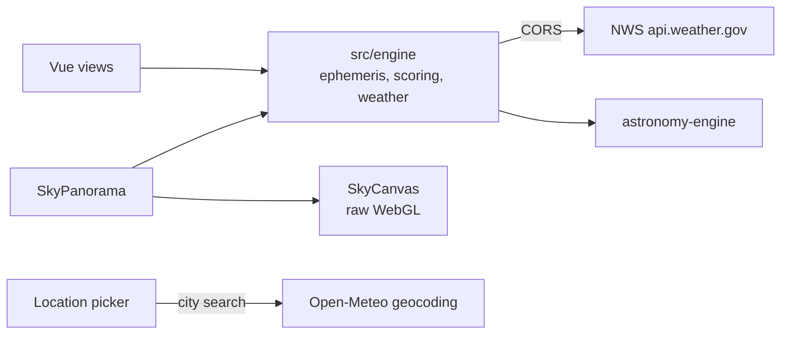

# Sky Hero Implementation Plan

> **For agentic workers:** REQUIRED SUB-SKILL: Use superpowers:subagent-driven-development (recommended) or superpowers:executing-plans to implement this plan task-by-task. Steps use checkbox (`- [ ]`) syntax for tracking.

**Goal:** Open the home page on a live, draggable WebGL panorama of tonight's sky with a sunset→sunrise scrubber, then document it in a README case study.

**Architecture:** `src/engine/sky.js` is pure math on top of `astronomy-engine` (one J2000→horizon matrix per instant, a stereographic camera, target lookup). `SkyCanvas.vue` draws sky, constellation lines, stars and a ridge silhouette with raw WebGL1, redrawing only on change. `SkyPanorama.vue` owns time, camera, overlay buttons, scrubber, intro and drag, and sits above the bento in `OverviewView`; it disappears entirely when WebGL is unavailable.

**Tech Stack:** Vue 3, `astronomy-engine`, GSAP 3.15 (`Draggable`, `InertiaPlugin`, both already installed), raw WebGL1, vitest + jsdom, Playwright / chrome-devtools MCP for browser checks, ffmpeg for the README GIF.

**Spec:** `docs/superpowers/specs/2026-10-05-sky-hero-design.md`

**Deploy is out of scope:** GitHub Pages, `public/CNAME`, the workflow and removing the `/api` proxy from `vite.config.js` belong to a separate deploy plan written later (the spec says the same).

**Working rules:** implement directly on branch `next_level` (no new branch, no worktree). Never leave build output in the repo: build only with `--outDir` in the scratchpad. No new dependencies. Commit messages are plain sentences, like the existing history. Comments follow the repo's style (no branch tags).

## Spec deviations (decided while planning)

1. `SkyPanorama` takes `bestHour` (ISO string) instead of `forecast`: `OverviewView` already computes the best dark hour (`bestWindow`), so it passes `bestWindow?.time`.
2. The tile renders directly **above** the bento grid (wrapper `<div class="overview">`), not as a grid item: `.tile-tall` is pinned to grid row 1 and would collide. It looks the same.
3. The ridge silhouette is drawn **last** (same shader, `uTerrain` on) so it hides stars behind it.
4. Tab order follows the visual order: sky, target rings, edge markers, scrubber.
5. `reduceMotion`, `tipIn`, `tipOut` move from `MoonMap.vue` to `src/motion.js` (second caller), so `MoonMap.vue` is edited.
6. On coarse pointers (phones) dragging only turns the view (`type: 'x'`), so vertical swipes still scroll the page; tilt there is via edge markers.
7. "Facing the #1 target" lifts the camera so the target sits up to 20° above centre (`turnTarget(view, altAz, 20)`), keeping the horizon in view; edge-marker turns centre the target.
8. Ring aria-labels use the existing `compass()` abbreviations: "Pleiades, messier, 28° up, ENE".

## Global Constraints

- No new dependencies; no three.js; raw WebGL1; no continuous animation loop; device pixel ratio capped at 2.
- Stars to magnitude 5.0, constellation lines and names from d3-celestial (© 2015 Olaf Frohn, BSD-3-Clause); `sky.json` under 30 KB gzip; its full licence notice ships with the site in `public/credits.txt` (the GitHub repo is private, so a README link would 404 for visitors).
- Top 5 `isDisplayable` targets per instrument, deduplicated by `id` (up to 10 rings).
- Stereographic camera; horizontal field `clamp(width / 7, 90, 180)` degrees; pitch 5–85°, default 25°.
- Scrubber sunset → sunrise in 5-minute steps; intro 4 s `power2.inOut`, daytime only; `prefers-reduced-motion` means no intro, no inertia, instant turns, no tooltip spring.
- Scrubbing highlights only the matching hourly chip (`.hour-chip.at`); the top-targets tile keeps its whole-night ranking.
- WebGL missing, shader failure, or context lost: the tile is removed and the bento is unchanged.
- All times shown in the **site's** time zone (`fmtTime(toLocalIso(date, location.timezone))`).
- Tests are network-free; run with `npx vitest run <files>`; extend `tests/OverviewView.test.js` rather than adding component test files.

## Review Focus

- A phone visitor swiping vertically over the sky expects the page to scroll, not the sky to tilt. Pinned in Task 3 (coarse pointer → `type: 'x'`).
- A reviewer in Europe viewing the Big Bend demo expects Big Bend's clock ("12:00 AM"), not their own. Pinned in Task 3 (same instant, `America/New_York` site → "1:00 AM").
- Changing location while the intro plays must stop the old intro; the time must stay inside the new night. Pinned in Task 3.
- A tonight plan in instant mode (the visitor used "at time" on the tonight page) or with an ID missing from the catalogs must still ring the known targets and skip the rest silently. Pinned in Task 3.
- Short summer nights with no astronomical dusk (Alaska) and midnight sun must still give a valid range and intro end. Pinned in Task 1.

## File Structure

| File | Responsibility |
|---|---|
| `src/engine/sky.json` (new) | Stars ≤ mag 5, figures, names (built once from d3-celestial). |
| `src/engine/sky.js` (new) | Pure sky math: frame, range, intro end, camera, edge markers, targets, terrain seed, star colour, Moon path. |
| `tests/sky.test.js` (new) | `sky.js` tests. |
| `src/components/SkyCanvas.vue` (new) | WebGL only: sky, lines, stars, ridge. |
| `src/components/SkyPanorama.vue` (new) | Tile: time, camera, overlay, scrubber, intro, drag, keys, live status. |
| `src/motion.js` (new) | `reduceMotion`, `tipIn`, `tipOut` shared with `MoonMap.vue`. |
| `src/components/MoonMap.vue` (edit) | Import the shared motion helpers. |
| `src/components/OverviewView.vue` (edit) | Mount the tile above the bento; `.at` hourly chip. |
| `src/App.vue` (edit) | Pass `location` to `OverviewView`. |
| `src/style.css` (edit) | Sky tile, overlay, scrubber, `.sr-only`, `.hour-chip.at`. |
| `tests/OverviewView.test.js` (edit) | Tile, overlay, time and motion behaviour. |
| `public/credits.txt` (new) | Credits and full licence notices, served with the site; the tile's "credits" link opens it. |
| `README.md` (new), `docs/sky-intro.gif` (new) | Case study; its Credits point to `public/credits.txt`. |

---

### Task 1: Sky data and math (`sky.json`, `sky.js`)

**Files:**
- Create: `src/engine/sky.json`, `src/engine/sky.js`
- Test: `tests/sky.test.js`

**Interfaces:**
- Consumes: `altaz`, `darkWindow`, `moonIllumination`, `moonIsWaxing`, `observerFor`, `PLANETS`, `twilightEvents`, `starAltAz` from `src/engine/astro.js`; `localDate`, `toLocalIso` from `src/engine/time.js`; `isDisplayable` from `src/format.js`; `catalogs.json`; `Rotation_EQJ_HOR` from `astronomy-engine`.
- Produces (all in `src/engine/sky.js`; angles in degrees; horizon vectors are `[x, y, z]` with x north, y west, z up):
  - `VISIBLE_Z = -0.17`
  - `unitVector(raHours, decDeg) -> [x, y, z]` (J2000)
  - `horizonVector({ alt, az }) -> [x, y, z]`; `altAzOf([x, y, z]) -> { alt, az }`
  - `rotate(m9, v) -> v` (m9 = flattened `rot[i][j]`, same as `RotateVector`)
  - `skyAt(location, date) -> { date, rot: number[9], sun: {alt, az}, moon: {alt, az, illum, waxing}, planets: [{ id: 'Mercury'…, alt, az }] }`
  - `darkness(frame) -> 0..1`; `starLimit(frame) -> magnitude`
  - `nightRange(location, now) -> { start: Date, end: Date, astroDusk: Date | null }`
  - `introEnd(range, bestHourIso | null) -> Date`
  - `fieldOfView(widthPx) -> degrees`
  - `camera({ yaw, pitch, hfov, width, height }) -> { yaw, pitch, hfov, width, height, fwd, right, up, scale, degPerPx, project(v) -> { x, y, visible, onScreen }, unproject(x, y) -> v }`
  - `edgeMarker(v, cam, inset = 28) -> { x, y, arrow }`
  - `turnTarget(view, { alt, az }, lift = 0) -> { yaw, pitch }`
  - `topTargets(instruments, per = 5) -> [target & { instruments: string[] }]`
  - `targetVector(id) -> [x, y, z] | null`; `targetHorizon(target, frame) -> [x, y, z] | null`
  - `terrainSeed(location) -> number[6]`; `starColor(bv) -> [r, g, b]`; `moonPath(illum, r) -> string`
  - `sky.json`: `{ stars: [[raHours, decDeg, mag, bv]], lines: [[[[raHours, decDeg], …], …]], names: [[abbr, name, raHours, decDeg]] }`

- [ ] **Step 1: Record the baseline bundle size.** Before any change, run `npx vite build --outDir <scratchpad>/dist --emptyOutDir` and note the gzip size Vite prints for `assets/index-*.js`; Task 4 compares against it.

- [ ] **Step 2: Build `sky.json`.** In the scratchpad (not the repo), download the three files and save this script as `<scratchpad>/d3c/build-sky.mjs`:

```bash
mkdir -p <scratchpad>/d3c && cd <scratchpad>/d3c
for f in stars.6.json constellations.lines.json constellations.json; do
  curl -sfL -o $f https://raw.githubusercontent.com/ofrohn/d3-celestial/master/data/$f
done
```

```js
// One-off: d3-celestial data → src/engine/sky.json. Run from the folder holding the three downloaded files.
import { readFileSync, writeFileSync } from 'node:fs'

const load = (f) => JSON.parse(readFileSync(f, 'utf8')).features
const r3 = (x) => Math.round(x * 1000) / 1000
const raHours = (lon) => r3(((lon % 360) + 360) % 360 / 15) // d3-celestial stores RA as longitude in -180..180°

const stars = load('stars.6.json')
  .filter((f) => f.properties.mag <= 5)
  .map(({ properties: { mag, bv }, geometry: { coordinates: [lon, dec] } }) =>
    [raHours(lon), r3(dec), r3(mag), bv == null || bv === '' ? 0.6 : r3(Number(bv))]) // 0.6 ≈ a white-yellow star

const lines = load('constellations.lines.json').map(({ geometry }) =>
  geometry.coordinates.map((line) => line.map(([lon, dec]) => [raHours(lon), r3(dec)])))

const names = load('constellations.json').map(({ id, properties: { name }, geometry: { coordinates: [lon, dec] } }) =>
  [id, name, raHours(lon), r3(dec)])

writeFileSync(process.argv[2], JSON.stringify({ stars, lines, names }))
console.log(`${stars.length} stars, ${lines.length} figures, ${names.length} names`)
```

Run: `cd <scratchpad>/d3c && node build-sky.mjs /home/mary/Programming/Astronomy/astro-dashboard/src/engine/sky.json && gzip -c /home/mary/Programming/Astronomy/astro-dashboard/src/engine/sky.json | wc -c`
Expected: `1627 stars, 89 figures, 89 names`; gzip size about 22,800 bytes (under 30,000).

- [ ] **Step 3: Write the failing tests.** Create `tests/sky.test.js`:

```js
import { describe, expect, it } from 'vitest'
import sky from '../src/engine/sky.json'
import expected from './fixtures/tonight-expected.json'
import { altaz, observerFor, starAltAz, twilightEvents } from '../src/engine/astro'
import { toLocalIso } from '../src/engine/time'
import {
  altAzOf, camera, darkness, edgeMarker, fieldOfView, horizonVector, introEnd, moonPath, nightRange, rotate, skyAt,
  starLimit, targetHorizon, targetVector, terrainSeed, topTargets, turnTarget, unitVector,
} from '../src/engine/sky'

const BIG_BEND = { name: 'Big Bend', latitude: 29.33, longitude: -103.21, elevationM: 1111, timezone: 'America/Chicago' }
const NIGHT = new Date('2026-10-06T05:00:00Z') // 00:00 CDT
const DAY = new Date('2026-10-05T18:00:00Z') // 13:00 CDT
const near = (a, b, tol) => expect(Math.abs(a - b)).toBeLessThan(tol)
const azNear = (a, b, tol) => expect(Math.abs(((a - b + 540) % 360) - 180)).toBeLessThan(tol)

describe('sky frame', () => {
  it('puts Polaris at the site latitude, due north', () => {
    const [ra, dec] = sky.stars.find(([, d]) => d > 89)
    const { alt, az } = altAzOf(rotate(skyAt(BIG_BEND, NIGHT).rot, unitVector(ra, dec)))
    near(alt, 29.33, 1)
    azNear(az, 0, 2)
  })

  it('agrees with starAltAz (precession and nutation included) for M42', () => {
    const got = altAzOf(rotate(skyAt(BIG_BEND, NIGHT).rot, unitVector(5.5883, -5.39)))
    const want = starAltAz(5.5883, -5.39, NIGHT, observerFor(BIG_BEND))
    near(got.alt, want.alt, 0.05)
    azNear(got.az, want.az, 0.05)
  })

  it('has the Sun at -0.83° at astro.js sunset', () => {
    const { sunset } = twilightEvents(BIG_BEND, '2026-10-05')
    near(skyAt(BIG_BEND, new Date(sunset)).sun.alt, -0.83, 0.2)
  })

  it('lists the planets by display name with altaz positions', () => {
    const uranus = skyAt(BIG_BEND, NIGHT).planets.find((p) => p.id === 'Uranus')
    expect(uranus).toEqual({ id: 'Uranus', ...altaz('uranus', NIGHT, observerFor(BIG_BEND)) })
  })

  it('is fully dark at midnight with the Moon down, and not yet dark at sunset', () => {
    const midnight = skyAt(BIG_BEND, NIGHT)
    expect(darkness(midnight)).toBe(1)
    expect(starLimit(midnight)).toBe(5) // the Moon is below the horizon then
    const { sunset } = twilightEvents(BIG_BEND, '2026-10-05')
    expect(darkness(skyAt(BIG_BEND, new Date(sunset)))).toBe(0)
  })

  it('round-trips horizon vectors and alt/az', () => {
    const { alt, az } = altAzOf(horizonVector({ alt: 33, az: 250 }))
    near(alt, 33, 1e-9)
    near(az, 250, 1e-9)
  })
})

describe('night range and intro end', () => {
  it('runs from sunset to sunrise of tonight in daytime and during the night', () => {
    const tw = twilightEvents(BIG_BEND, '2026-10-05')
    for (const now of [DAY, NIGHT]) {
      const r = nightRange(BIG_BEND, now)
      expect(r.start.toISOString()).toBe(new Date(tw.sunset).toISOString())
      expect(r.end.toISOString()).toBe(new Date(tw.sunrise).toISOString())
      expect(r.astroDusk.toISOString()).toBe(new Date(tw.astroDusk).toISOString())
    }
  })

  it('ends the intro at the best hour if it is inside the night, else astronomical dusk, else mid-night', () => {
    const r = nightRange(BIG_BEND, DAY)
    expect(introEnd(r, '2026-10-05T23:00:00-05:00').toISOString()).toBe('2026-10-06T04:00:00.000Z')
    expect(introEnd(r, '2026-10-07T23:00:00-05:00')).toBe(r.astroDusk) // a different night's hour
    expect(introEnd(r, null)).toBe(r.astroDusk)
    const noDusk = { ...r, astroDusk: null }
    expect(introEnd(noDusk, null).getTime()).toBe((r.start.getTime() + r.end.getTime()) / 2)
  })

  it('falls back to the 21:00–05:00 window under the midnight sun', () => {
    const utqiagvik = { name: 'Utqiagvik', latitude: 71.29, longitude: -156.79, timezone: 'America/Anchorage' }
    const r = nightRange(utqiagvik, new Date('2026-06-21T20:00:00Z'))
    expect(toLocalIso(r.start, utqiagvik.timezone).slice(11, 16)).toBe('21:00')
    expect(r.end - r.start).toBe(8 * 3_600_000)
    expect(r.astroDusk).toBeNull()
  })

  it('gives a short Alaskan summer night a valid range and a mid-night intro end', () => {
    const fairbanks = { name: 'Fairbanks', latitude: 64.84, longitude: -147.72, timezone: 'America/Anchorage' }
    const r = nightRange(fairbanks, new Date('2026-06-21T20:00:00Z'))
    expect(r.end > r.start).toBe(true)
    expect(r.astroDusk).toBeNull()
    expect(introEnd(r, null).getTime()).toBe((r.start.getTime() + r.end.getTime()) / 2)
  })
})

describe('camera', () => {
  const cam = camera({ yaw: 120, pitch: 25, hfov: 180, width: 1300, height: 500 })

  it('puts the view direction at the centre and inverts its own projection', () => {
    const c = cam.project(cam.fwd)
    near(c.x, 650, 1e-9)
    near(c.y, 250, 1e-9)
    const p = cam.project(cam.unproject(200, 100))
    near(p.x, 200, 1e-6)
    near(p.y, 100, 1e-6)
  })

  it('maps the edge of the field to the edge of the tile, and hides points behind the viewer', () => {
    near(cam.project(horizonVector({ alt: 0, az: 210 })).x, 1300, 1e-6) // 90° right of yaw 120 at the horizon
    expect(cam.project(horizonVector({ alt: 0, az: 300 })).visible).toBe(false)
  })

  it('shows east on the left when facing south', () => {
    const south = camera({ yaw: 180, pitch: 10, hfov: 180, width: 1000, height: 400 })
    expect(south.project(horizonVector({ alt: 10, az: 135 })).x).toBeLessThan(500)
  })

  it('sizes the field from the tile width', () => {
    expect(fieldOfView(1300)).toBe(180)
    expect(fieldOfView(375)).toBe(90)
    near(fieldOfView(1000), 142.857, 0.001)
  })

  it('pins off-screen points to the matching edge with an arrow', () => {
    const south = camera({ yaw: 180, pitch: 25, hfov: 120, width: 1000, height: 400 })
    const east = edgeMarker(horizonVector({ alt: 20, az: 90 }), south)
    expect(east.arrow).toBe('←')
    expect(east.x).toBeCloseTo(28, 6)
    const high = edgeMarker(horizonVector({ alt: 85, az: 180 }), south)
    expect(high.arrow).toBe('↑')
    expect(high.y).toBeCloseTo(28, 6)
  })

  it('turns the short way round and keeps the horizon in sight', () => {
    expect(turnTarget({ yaw: 350, pitch: 40 }, { alt: 10, az: 10 })).toEqual({ yaw: 370, pitch: 25 })
    expect(turnTarget({ yaw: 10, pitch: 40 }, { alt: 54, az: 350 })).toEqual({ yaw: -10, pitch: 54 })
    expect(turnTarget({ yaw: 0, pitch: 25 }, { alt: 60, az: 90 }, 20)).toEqual({ yaw: 90, pitch: 40 })
  })
})

describe('targets', () => {
  it('finds catalogue coordinates for every non-planet, non-Moon target in the tonight fixture', () => {
    for (const mode of ['window', 'instant']) {
      for (const list of Object.values(expected[mode].instruments)) {
        for (const t of list.filter((x) => !['planet', 'moon'].includes(x.targetClass))) {
          expect(targetVector(t.id), t.id).not.toBeNull()
        }
      }
    }
  })

  it('keeps 5 per instrument, merging M45 (in both lists) into one entry with both instruments', () => {
    const top = topTargets(expected.window.instruments)
    expect(top).toHaveLength(9)
    expect(top.filter((t) => t.id === 'M45')).toHaveLength(1)
    expect(top.find((t) => t.id === 'M45').instruments).toEqual(['dob_8inch', 'dwarf_mini'])
  })

  it('skips targets that are not displayable', () => {
    const t = (id, score) => ({ id, score })
    expect(topTargets({ a: [t('M1', 0), t('M2', 10)] }).map((x) => x.id)).toEqual(['M2'])
    expect(topTargets(null)).toEqual([])
  })

  it('places planets from the frame, catalogue targets through the matrix, and unknown ids nowhere', () => {
    const frame = skyAt(BIG_BEND, NIGHT)
    expect(targetHorizon({ id: 'Uranus', targetClass: 'planet' }, frame))
      .toEqual(horizonVector(frame.planets.find((p) => p.id === 'Uranus')))
    expect(targetHorizon({ id: 'Moon', targetClass: 'moon' }, frame)).toEqual(horizonVector(frame.moon))
    expect(targetHorizon({ id: 'M45', targetClass: 'messier' }, frame)).toEqual(rotate(frame.rot, targetVector('M45')))
    expect(targetHorizon({ id: 'nowhere', targetClass: 'messier' }, frame)).toBeNull()
  })
})

describe('drawing helpers', () => {
  it('seeds the ridge from the coordinates', () => {
    const seed = terrainSeed(BIG_BEND)
    expect(seed).toHaveLength(6)
    expect(seed.every((x) => x >= 0 && x < 1)).toBe(true)
    expect(terrainSeed({ latitude: 47.61, longitude: -122.33 })).not.toEqual(seed)
  })

  it('bulges the terminator the right way for crescent and gibbous phases', () => {
    expect(moonPath(0.25, 9)).toBe('M 0 -9 A 9 9 0 0 1 0 9 A 4.5 9 0 0 0 0 -9 Z')
    expect(moonPath(0.75, 9)).toBe('M 0 -9 A 9 9 0 0 1 0 9 A 4.5 9 0 0 1 0 -9 Z')
  })
})
```

- [ ] **Step 4: Run the tests to verify they fail.**

Run: `npx vitest run tests/sky.test.js`
Expected: FAIL, "Failed to resolve import ../src/engine/sky" (or equivalent).

- [ ] **Step 5: Implement `src/engine/sky.js`.**

```js
import { Rotation_EQJ_HOR } from 'astronomy-engine'
import catalogs from './catalogs.json'
import { PLANETS, altaz, darkWindow, moonIllumination, moonIsWaxing, observerFor, twilightEvents } from './astro'
import { localDate } from './time'
import { isDisplayable } from '../format'

const RAD = Math.PI / 180
const dot = (a, b) => a[0] * b[0] + a[1] * b[1] + a[2] * b[2]
const cross = (a, b) => [a[1] * b[2] - a[2] * b[1], a[2] * b[0] - a[0] * b[2], a[0] * b[1] - a[1] * b[0]]
const clamp = (x, lo, hi) => Math.min(hi, Math.max(lo, x))
const smoothstep = (a, b, x) => { const t = clamp((x - a) / (b - a), 0, 1); return t * t * (3 - 2 * t) }

/** Points more than ~100° from the view direction aren't drawn: stereographic blows up toward 180°. */
export const VISIBLE_Z = -0.17

/** J2000 unit vector of a right ascension (hours) and declination (degrees). */
export function unitVector(raHours, decDeg) {
  const ra = raHours * 15 * RAD
  const dec = decDeg * RAD
  return [Math.cos(dec) * Math.cos(ra), Math.cos(dec) * Math.sin(ra), Math.sin(dec)]
}

// Horizontal frame as in astronomy-engine: x north, y west, z zenith; azimuth from north through east.
export function horizonVector({ alt, az }) {
  const a = alt * RAD
  const z = az * RAD
  return [Math.cos(a) * Math.cos(z), -Math.cos(a) * Math.sin(z), Math.sin(a)]
}
export const altAzOf = ([x, y, z]) => ({ alt: Math.asin(clamp(z, -1, 1)) / RAD, az: (Math.atan2(-y, x) / RAD + 360) % 360 })

/** Flattened astronomy-engine `rot[i][j]` applied as RotateVector does; uniformMatrix3fv(loc, false, m) matches in GLSL. */
export const rotate = (m, [x, y, z]) =>
  [m[0] * x + m[3] * y + m[6] * z, m[1] * x + m[4] * y + m[7] * z, m[2] * x + m[5] * y + m[8] * z]

const cap = (s) => s[0].toUpperCase() + s.slice(1)

/** What moves, at `date`: the J2000→horizon matrix, the Sun, the Moon (with phase) and the planets. */
export function skyAt(location, date) {
  const observer = observerFor(location)
  return {
    date,
    rot: Rotation_EQJ_HOR(date, observer).rot.flat(),
    sun: altaz('sun', date, observer),
    moon: { ...altaz('moon', date, observer), illum: moonIllumination(date), waxing: moonIsWaxing(date) },
    planets: PLANETS.map((key) => ({ id: cap(key), ...altaz(key, date, observer) })),
  }
}

/** 0 until the Sun is 6° down, 1 once it is 18° down. */
export const darkness = (frame) => smoothstep(6, 18, -frame.sun.alt)

/** Faintest magnitude drawn: 0 at dusk, 5 in full dark, up to 1 brighter limit lost to a bright Moon above the horizon. */
export const starLimit = (frame) => 5 * darkness(frame) - (frame.moon.alt > 0 ? frame.moon.illum : 0)

/**
 * Tonight's scrubber range: sunset to sunrise of the night `darkWindow` picks, or that window where the Sun doesn't set
 * or rise. `astroDusk` is null on nights without astronomical darkness.
 */
export function nightRange(location, now) {
  const win = darkWindow(location, now)
  const tw = twilightEvents(location, localDate(win.start, location.timezone))
  const date = (iso) => (iso ? new Date(iso) : null)
  const astroDusk = date(tw.astroDusk)
  return tw.sunset && tw.sunrise ? { start: date(tw.sunset), end: date(tw.sunrise), astroDusk } : { ...win, astroDusk }
}

/** Where the intro stops: `bestHour` (ISO) if it falls inside `range`, else astronomical dusk, else mid-range. */
export function introEnd(range, bestHour) {
  const t = Date.parse(bestHour ?? '')
  if (t >= range.start && t <= range.end) return new Date(t)
  return range.astroDusk ?? new Date((range.start.getTime() + range.end.getTime()) / 2)
}

/** Horizontal field of view for a tile `width` CSS px wide: about 7 px per degree, from 90° to 180°. */
export const fieldOfView = (width) => clamp(width / 7, 90, 180)

/**
 * Stereographic camera looking at azimuth `yaw`, altitude `pitch`, `hfov` degrees across `width` × `height` CSS px.
 * `project` maps a horizon vector to tile px (y down); `unproject` is its inverse.
 */
export function camera({ yaw, pitch, hfov, width, height }) {
  const y0 = yaw * RAD
  const p0 = pitch * RAD
  const fwd = [Math.cos(p0) * Math.cos(y0), -Math.cos(p0) * Math.sin(y0), Math.sin(p0)]
  const right = [-Math.sin(y0), -Math.cos(y0), 0]
  const up = cross(right, fwd)
  const scale = width / 2 / (2 * Math.tan(hfov * RAD / 4)) // px per stereographic unit: the field's edge is the tile's edge
  return {
    yaw, pitch, hfov, width, height, fwd, right, up, scale,
    degPerPx: 1 / (scale * RAD),
    project(v) {
      const z = dot(v, fwd)
      const k = 2 / (1 + z)
      const x = width / 2 + k * dot(v, right) * scale
      const y = height / 2 - k * dot(v, up) * scale
      const visible = z > VISIBLE_Z
      return { x, y, visible, onScreen: visible && x >= 0 && x <= width && y >= 0 && y <= height }
    },
    unproject(x, y) {
      const sx = (x - width / 2) / scale
      const sy = (height / 2 - y) / scale
      const d = 4 + sx * sx + sy * sy
      const [a, b, c] = [4 * sx / d, 4 * sy / d, (8 - d) / d]
      return [0, 1, 2].map((i) => a * right[i] + b * up[i] + c * fwd[i])
    },
  }
}

/** Spot on the tile's edge (`inset` px in) toward an off-screen horizon vector, with an arrow pointing at it. */
export function edgeMarker(v, cam, inset = 28) {
  const a = Math.atan2(dot(v, cam.up), dot(v, cam.right)) // on-screen direction from the centre, counter-clockwise
  const hw = cam.width / 2 - inset
  const hh = cam.height / 2 - inset
  const t = Math.min(hw / Math.abs(Math.cos(a) || 1e-9), hh / Math.abs(Math.sin(a) || 1e-9))
  const deg = a / RAD
  const arrow = Math.abs(deg) <= 45 ? '→' : deg > 45 && deg < 135 ? '↑' : deg < -45 && deg > -135 ? '↓' : '←'
  return { x: cam.width / 2 + Math.cos(a) * t, y: cam.height / 2 - Math.sin(a) * t, arrow }
}

/** Camera angles that put `altAz` `lift` degrees above centre, turning the short way and keeping the horizon in sight. */
export function turnTarget(view, { alt, az }, lift = 0) {
  return { yaw: view.yaw + (((az - view.yaw) % 360) + 540) % 360 - 180, pitch: clamp(alt - lift, 25, 85) }
}

/** The first `per` displayable targets of each instrument, one entry per id listing every instrument that has it. */
export function topTargets(instruments, per = 5) {
  const byId = new Map()
  for (const [instrument, list] of Object.entries(instruments ?? {})) {
    for (const t of list.filter(isDisplayable).slice(0, per)) {
      if (byId.has(t.id)) byId.get(t.id).instruments.push(instrument)
      else byId.set(t.id, { ...t, instruments: [instrument] })
    }
  }
  return [...byId.values()]
}

const CATALOG = new Map([
  ...catalogs.messier.map((o) => [o.id, o]),
  ...catalogs.ngc.map((o) => [o.id, o]),
  ...catalogs.watchlist.map((o) => [o.designation, o]),
])

/** J2000 unit vector of a catalogue target (Messier, NGC by id, watchlist by designation); null if unknown. */
export function targetVector(id) {
  const o = CATALOG.get(id)
  return o?.raHours == null || o.decDegrees == null ? null : unitVector(o.raHours, o.decDegrees)
}

/** Horizon vector of a tonight-plan target in `frame`, or null when its position is unknown. */
export function targetHorizon(target, frame) {
  if (target.targetClass === 'planet') {
    const p = frame.planets.find((q) => q.id === target.id)
    return p ? horizonVector(p) : null
  }
  if (target.targetClass === 'moon') return horizonVector(frame.moon)
  const v = targetVector(target.id)
  return v && rotate(frame.rot, v)
}

/** Six numbers in [0, 1) from the coordinates, so each place gets its own decorative ridge line. */
export function terrainSeed({ latitude, longitude }) {
  return Array.from({ length: 6 }, (_, i) => {
    const x = Math.sin(latitude * 12.9898 + longitude * 78.233 + i * 37.719) * 43758.5453
    return x - Math.floor(x)
  })
}

const BV_STOPS = [[-0.4, [0.61, 0.69, 1]], [0, [0.8, 0.85, 1]], [0.6, [1, 0.96, 0.91]], [1.2, [1, 0.82, 0.63]], [2, [1, 0.68, 0.32]]]
/** Star colour (linear RGB 0..1) from its B−V colour index. */
export function starColor(bv) {
  const b = clamp(bv, -0.4, 2)
  const i = Math.max(1, BV_STOPS.findIndex(([x]) => x >= b))
  const [[x0, c0], [x1, c1]] = [BV_STOPS[i - 1], BV_STOPS[i]]
  return c0.map((c, k) => c + (c1[k] - c) * ((b - x0) / (x1 - x0)))
}

/** SVG path of the lit part of a Moon disc of radius `r` and lit fraction `illum`, lit limb toward +x. */
export function moonPath(illum, r) {
  const rx = Math.abs(2 * illum - 1) * r
  return `M 0 ${-r} A ${r} ${r} 0 0 1 0 ${r} A ${rx} ${r} 0 0 ${illum > 0.5 ? 1 : 0} 0 ${-r} Z`
}
```

- [ ] **Step 6: Run the tests to verify they pass.**

Run: `npx vitest run tests/sky.test.js`
Expected: PASS (all). If the Fairbanks case fails because `r.end > r.start` is false, print `nightRange(fairbanks, …)` and fix `nightRange`, not the test.

- [ ] **Step 7: Commit.**

```bash
git add src/engine/sky.json src/engine/sky.js tests/sky.test.js
git commit -m "Sky math: J2000-to-horizon frame, stereographic camera, night range and targets"
```

---

### Task 2: `SkyCanvas` and the tile above the bento

**Files:**
- Create: `src/components/SkyCanvas.vue`, `src/components/SkyPanorama.vue` (skeleton; Task 3 replaces it)
- Modify: `src/components/OverviewView.vue`, `src/App.vue`, `src/style.css`
- Test: `tests/OverviewView.test.js`

**Interfaces:**
- Consumes: `skyAt`, `camera`, `fieldOfView`, `terrainSeed`, `darkness`, `starLimit`, `starColor`, `unitVector`, `horizonVector`, `VISIBLE_Z` and `sky.json` from Task 1.
- Produces:
  - `<SkyCanvas :frame :cam :seed @failed>`: `frame` = `skyAt(...)`, `cam` = `camera(...)`, `seed` = `terrainSeed(...)`; emits `failed` (no args) when WebGL is missing, setup fails, or the context is lost.
  - `<SkyPanorama :location @failed>` (Task 3 adds `:tonight`, `:best-hour`, `@time`).
  - `OverviewView` prop `location` (Object, default null). No location → no tile.
  - CSS classes `.sky-tile`, `.sky-stage`, `.sky-canvas`.

- [ ] **Step 1: Write the failing tests.** In `tests/OverviewView.test.js`, change the imports at the top to:

```js
import { afterEach, describe, expect, it, vi } from 'vitest'
import { flushPromises, mount } from '@vue/test-utils'
import OverviewView from '../src/components/OverviewView.vue'
```

and append at the end of the file:

```js
const location = { name: 'Big Bend National Park, TX', latitude: 29.33, longitude: -103.21, elevationM: 1111,
                   timezone: 'America/Chicago' }
const stubGl = () => {
  vi.stubGlobal('WebGLRenderingContext', function () {})
  const gl = new Proxy({}, { get: () => () => ({}) }) // every GL call is a no-op
  vi.spyOn(HTMLCanvasElement.prototype, 'getContext').mockReturnValue(gl)
}
afterEach(() => { vi.unstubAllGlobals(); vi.restoreAllMocks(); vi.useRealTimers() })

describe('OverviewView sky tile', () => {
  it('has no sky tile without a location', () => {
    stubGl()
    expect(mount(OverviewView, { props: allProps }).find('.sky-tile').exists()).toBe(false)
  })

  it('shows the sky tile above the bento when WebGL works', async () => {
    stubGl()
    const w = mount(OverviewView, { props: { ...allProps, location } })
    await flushPromises()
    expect(w.find('.sky-tile canvas').exists()).toBe(true)
    expect(w.find('.sky-tile').attributes('aria-label')).toBe('Sky over Big Bend National Park, TX tonight')
    expect(w.find('.sky-tile').element.nextElementSibling.classList.contains('bento')).toBe(true)
  })

  it('drops the sky tile and keeps the bento when WebGL is missing', async () => {
    const w = mount(OverviewView, { props: { ...allProps, location } }) // jsdom has no WebGLRenderingContext
    await flushPromises()
    expect(w.find('.sky-tile').exists()).toBe(false)
    expect(w.find('.card-conditions').exists()).toBe(true)
  })

  it('drops the sky tile when the WebGL context is lost', async () => {
    stubGl()
    const w = mount(OverviewView, { props: { ...allProps, location } })
    await flushPromises()
    w.find('.sky-tile canvas').element.dispatchEvent(new Event('webglcontextlost'))
    await flushPromises()
    expect(w.find('.sky-tile').exists()).toBe(false)
  })
})
```

- [ ] **Step 2: Run the tests to verify they fail.**

Run: `npx vitest run tests/OverviewView.test.js`
Expected: the new "shows the sky tile…" and "context is lost" tests FAIL (no `.sky-tile`); existing tests pass.

- [ ] **Step 3: Create `src/components/SkyCanvas.vue`.**

```vue
<script setup>
import { onBeforeUnmount, onMounted, ref, watch } from 'vue'
import skyData from '../engine/sky.json'
import { VISIBLE_Z, darkness, horizonVector, starColor, starLimit, unitVector } from '../engine/sky'

const props = defineProps({
  frame: { type: Object, required: true }, // skyAt(...)
  cam: { type: Object, required: true }, // camera(...)
  seed: { type: Array, required: true }, // terrainSeed(...)
})
const emit = defineEmits(['failed'])
const canvas = ref(null)
const dpr = Math.min(window.devicePixelRatio || 1, 2)

// Star and line programs share this: J2000 → horizon (uRot) → camera → stereographic → clip space.
const PROJECT = `
uniform mat3 uRot;
uniform vec3 uRight, uUp, uFwd;
uniform vec2 uK;
const vec4 HIDDEN = vec4(2.0, 2.0, 2.0, 1.0);
vec4 clipOf(vec3 h) {
  float k = 2.0 / (1.0 + dot(h, uFwd));
  return vec4(k * dot(h, uRight) * uK.x, k * dot(h, uUp) * uK.y, 0.0, 1.0);
}`
const QUAD_VERT = `attribute vec2 aPos;
void main() { gl_Position = vec4(aPos, 0.0, 1.0); }`
// Each pixel is unprojected to a horizon direction; uTerrain draws only the ridge (last, so it hides stars behind it).
const SKY_FRAG = `precision highp float;
uniform vec2 uSize;
uniform float uScale;
uniform vec3 uRight, uUp, uFwd, uSunDir, uMoonDir;
uniform float uSunAlt, uMoonLight;
uniform vec3 uAmp, uPhase;
uniform bool uTerrain;
const float DEG = 57.29578;
vec3 ramp(vec3 c0, vec3 c6, vec3 c12, vec3 c18, float t) {
  if (t < 6.0) return mix(c0, c6, t / 6.0);
  if (t < 12.0) return mix(c6, c12, (t - 6.0) / 6.0);
  return mix(c12, c18, (t - 12.0) / 6.0);
}
// Decorative ridge height in degrees; whole-number harmonics so it joins up at north.
float ridge(float az) {
  return 0.8 + 0.8 * uAmp.x * (0.5 + 0.5 * sin(2.0 * az + 6.2832 * uPhase.x))
             + 0.8 * uAmp.y * (0.5 + 0.5 * sin(5.0 * az + 6.2832 * uPhase.y))
             + 0.6 * uAmp.z * (0.5 + 0.5 * sin(11.0 * az + 6.2832 * uPhase.z));
}
void main() {
  vec2 s = (gl_FragCoord.xy - 0.5 * uSize) / uScale;
  float d2 = 4.0 + dot(s, s);
  vec3 d = (4.0 * s.x * uRight + 4.0 * s.y * uUp + (8.0 - d2) * uFwd) / d2;
  float alt = asin(clamp(d.z, -1.0, 1.0)) * DEG;
  if (uTerrain) {
    float h = ridge(atan(-d.y, d.x));
    if (alt > h) discard;
    gl_FragColor = vec4(mix(vec3(0.012, 0.016, 0.03), vec3(0.07, 0.08, 0.13), smoothstep(h - 0.3, h, alt)), 1.0);
    return;
  }
  float t = clamp(-uSunAlt, 0.0, 18.0);
  vec3 zenith = ramp(vec3(0.23, 0.36, 0.60), vec3(0.11, 0.17, 0.35), vec3(0.05, 0.08, 0.19), vec3(0.02, 0.03, 0.07), t);
  vec3 horizon = ramp(vec3(0.94, 0.66, 0.41), vec3(0.75, 0.42, 0.29), vec3(0.16, 0.16, 0.31), vec3(0.04, 0.06, 0.13), t);
  vec3 col = mix(zenith, horizon, pow(1.0 - clamp(alt / 90.0, 0.0, 1.0), 3.0));
  float sun = acos(clamp(dot(d, uSunDir), -1.0, 1.0));
  col += vec3(1.0, 0.6, 0.35) * 0.6 * exp(-sun / 0.45) * (1.0 - smoothstep(0.0, 15.0, t));
  float moon = acos(clamp(dot(d, uMoonDir), -1.0, 1.0));
  col += vec3(0.62, 0.7, 0.85) * uMoonLight * (0.35 * exp(-moon / 0.12) + 0.08 * exp(-moon / 0.7));
  gl_FragColor = vec4(col, 1.0);
}`
const STAR_VERT = `${PROJECT}
attribute vec3 aPos;
attribute float aMag;
attribute vec3 aColor;
uniform float uLimit, uDpr;
varying vec3 vColor;
varying float vAlpha;
void main() {
  vec3 h = uRot * aPos;
  vColor = aColor;
  vAlpha = clamp((uLimit - aMag) / 1.5 + 0.3, 0.0, 1.0);
  gl_PointSize = clamp(4.0 - 0.6 * aMag, 1.2, 6.0) * uDpr;
  gl_Position = dot(h, uFwd) < ${VISIBLE_Z} ? HIDDEN : clipOf(h);
}`
const STAR_FRAG = `precision mediump float;
varying vec3 vColor;
varying float vAlpha;
void main() {
  float a = vAlpha * smoothstep(1.0, 0.3, length(gl_PointCoord - 0.5) * 2.0);
  gl_FragColor = vec4(vColor * a, a); // premultiplied
}`
// Each vertex also carries its segment's other end, so a segment with either end out of view collapses.
const LINE_VERT = `${PROJECT}
attribute vec3 aPos;
attribute vec3 aOther;
void main() {
  vec3 h = uRot * aPos;
  bool hidden = min(dot(h, uFwd), dot(uRot * aOther, uFwd)) < ${VISIBLE_Z};
  gl_Position = hidden ? HIDDEN : clipOf(h);
}`
const LINE_FRAG = `precision mediump float;
uniform float uAlpha;
void main() { gl_FragColor = vec4(vec3(0.55, 0.65, 0.9) * uAlpha, uAlpha); }`

let gl = null
let progs = null
let buffers = null
let starCount = 0
let lineCount = 0

function compile(vert, frag) {
  const shader = (type, src) => {
    const s = gl.createShader(type)
    gl.shaderSource(s, src)
    gl.compileShader(s)
    if (!gl.getShaderParameter(s, gl.COMPILE_STATUS)) throw new Error(gl.getShaderInfoLog(s))
    return s
  }
  const prog = gl.createProgram()
  gl.attachShader(prog, shader(gl.VERTEX_SHADER, vert))
  gl.attachShader(prog, shader(gl.FRAGMENT_SHADER, frag))
  gl.linkProgram(prog)
  if (!gl.getProgramParameter(prog, gl.LINK_STATUS)) throw new Error(gl.getProgramInfoLog(prog))
  const locs = {}
  return { prog, u: (name) => (locs[name] ??= gl.getUniformLocation(prog, name)), a: (name) => gl.getAttribLocation(prog, name) }
}

function buffer(data) {
  const b = gl.createBuffer()
  gl.bindBuffer(gl.ARRAY_BUFFER, b)
  gl.bufferData(gl.ARRAY_BUFFER, new Float32Array(data), gl.STATIC_DRAW)
  return b
}

function setup() {
  progs = { sky: compile(QUAD_VERT, SKY_FRAG), stars: compile(STAR_VERT, STAR_FRAG), lines: compile(LINE_VERT, LINE_FRAG) }
  const { stars, lines } = skyData
  const v = ([ra, dec]) => unitVector(ra, dec)
  const segs = lines.flatMap((figure) => figure.flatMap((line) => line.slice(1).map((p, i) => [line[i], p])))
  starCount = stars.length
  lineCount = segs.length * 2
  buffers = {
    quad: buffer([-1, -1, 1, -1, -1, 1, 1, 1]),
    starPos: buffer(stars.flatMap(([ra, dec]) => unitVector(ra, dec))),
    starMag: buffer(stars.map((s) => s[2])),
    starColor: buffer(stars.flatMap((s) => starColor(s[3]))),
    linePos: buffer(segs.flatMap(([a, b]) => [...v(a), ...v(b)])),
    lineOther: buffer(segs.flatMap(([a, b]) => [...v(b), ...v(a)])),
  }
  gl.enable(gl.BLEND)
  gl.blendFunc(gl.ONE, gl.ONE_MINUS_SRC_ALPHA) // premultiplied alpha
}

/** One draw call: program, its uniforms, then `attribs` ({ name: [buffer, size] }), disabled again afterwards. */
function draw(p, setUniforms, attribs, mode, count) {
  gl.useProgram(p.prog)
  setUniforms(p)
  const used = Object.entries(attribs).map(([name, [b, size]]) => {
    const loc = p.a(name)
    gl.bindBuffer(gl.ARRAY_BUFFER, b)
    gl.enableVertexAttribArray(loc)
    gl.vertexAttribPointer(loc, size, gl.FLOAT, false, 0, 0)
    return loc
  })
  gl.drawArrays(mode, 0, count)
  used.forEach((loc) => gl.disableVertexAttribArray(loc))
}

function render() {
  const { frame, cam, seed } = props
  const el = canvas.value
  const w = Math.round(cam.width * dpr)
  const h = Math.round(cam.height * dpr)
  if (el.width !== w || el.height !== h) { el.width = w; el.height = h }
  gl.viewport(0, 0, w, h)
  const view = (p) => {
    gl.uniform3fv(p.u('uRight'), cam.right)
    gl.uniform3fv(p.u('uUp'), cam.up)
    gl.uniform3fv(p.u('uFwd'), cam.fwd)
  }
  const projected = (p) => {
    view(p)
    gl.uniformMatrix3fv(p.u('uRot'), false, frame.rot)
    gl.uniform2f(p.u('uK'), 2 * cam.scale / cam.width, 2 * cam.scale / cam.height)
  }
  const sky = (terrain) => (p) => {
    view(p)
    gl.uniform2f(p.u('uSize'), w, h)
    gl.uniform1f(p.u('uScale'), cam.scale * dpr)
    gl.uniform3fv(p.u('uSunDir'), horizonVector(frame.sun))
    gl.uniform3fv(p.u('uMoonDir'), horizonVector(frame.moon))
    gl.uniform1f(p.u('uSunAlt'), frame.sun.alt)
    gl.uniform1f(p.u('uMoonLight'), frame.moon.alt > 0 ? frame.moon.illum : 0)
    gl.uniform3fv(p.u('uAmp'), seed.slice(0, 3))
    gl.uniform3fv(p.u('uPhase'), seed.slice(3))
    gl.uniform1i(p.u('uTerrain'), terrain ? 1 : 0)
  }
  const quad = { aPos: [buffers.quad, 2] }
  draw(progs.sky, sky(false), quad, gl.TRIANGLE_STRIP, 4)
  draw(progs.lines, (p) => { projected(p); gl.uniform1f(p.u('uAlpha'), 0.22 * darkness(frame)) },
       { aPos: [buffers.linePos, 3], aOther: [buffers.lineOther, 3] }, gl.LINES, lineCount)
  draw(progs.stars, (p) => { projected(p); gl.uniform1f(p.u('uLimit'), starLimit(frame)); gl.uniform1f(p.u('uDpr'), dpr) },
       { aPos: [buffers.starPos, 3], aMag: [buffers.starMag, 1], aColor: [buffers.starColor, 3] }, gl.POINTS, starCount)
  draw(progs.sky, sky(true), quad, gl.TRIANGLE_STRIP, 4)
}

// Redraw at most once per animation frame, and only when something changed: no loop runs while idle.
let queued = 0
const schedule = () => { if (progs && !queued) queued = requestAnimationFrame(() => { queued = 0; render() }) }
watch(() => [props.frame, props.cam, props.seed], schedule)

const fail = () => emit('failed')
onMounted(() => {
  if (typeof WebGLRenderingContext === 'undefined') return fail()
  gl = canvas.value.getContext('webgl', { antialias: true })
  if (!gl) return fail()
  canvas.value.addEventListener('webglcontextlost', fail)
  try { setup() } catch { progs = null; return fail() }
  schedule()
})
onBeforeUnmount(() => {
  cancelAnimationFrame(queued)
  canvas.value?.removeEventListener('webglcontextlost', fail)
})
</script>

<template>
  <canvas ref="canvas" class="sky-canvas" aria-hidden="true" />
</template>
```

- [ ] **Step 4: Create the skeleton `src/components/SkyPanorama.vue`** (Task 3 replaces the whole file).

```vue
<script setup>
import { computed, onBeforeUnmount, onMounted, reactive, ref } from 'vue'
import { camera, fieldOfView, skyAt, terrainSeed } from '../engine/sky'
import SkyCanvas from './SkyCanvas.vue'

const props = defineProps({ location: { type: Object, required: true } })
const emit = defineEmits(['failed'])

const stage = ref(null)
const size = reactive({ width: 1000, height: 385 }) // jsdom has no layout; the ResizeObserver takes over in browsers
const view = reactive({ yaw: 180, pitch: 25 })
const frame = computed(() => skyAt(props.location, new Date()))
const cam = computed(() => camera({ ...view, hfov: fieldOfView(size.width), width: size.width, height: size.height }))
const seed = computed(() => terrainSeed(props.location))

let observer = null
onMounted(() => {
  if (typeof ResizeObserver === 'undefined') return
  observer = new ResizeObserver(([e]) => {
    if (e.contentRect.width > 0) { size.width = e.contentRect.width; size.height = e.contentRect.height }
  })
  observer.observe(stage.value)
})
onBeforeUnmount(() => observer?.disconnect())
</script>

<template>
  <section class="panel sky-tile" :aria-label="`Sky over ${location.name} tonight`">
    <div ref="stage" class="sky-stage">
      <SkyCanvas :frame="frame" :cam="cam" :seed="seed" @failed="emit('failed')" />
    </div>
  </section>
</template>
```

- [ ] **Step 5: Mount it in `OverviewView.vue`.**
  - Change `import { computed } from 'vue'` to `import { computed, ref } from 'vue'` and add `import SkyPanorama from './SkyPanorama.vue'` after the `NightTimes` import.
  - In `defineProps`, add as the first prop: `location: { type: Object, default: null },`
  - After `const props = defineProps(...)`, add: `const skyFailed = ref(false)`
  - In the template, replace the opening `<section class="overview bento">` with:

```html
  <div class="overview">
  <SkyPanorama v-if="location && !skyFailed" :location="location" @failed="skyFailed = true" />
  <section class="bento">
```

  - and replace the final `</section>` (just before `</template>`) with:

```html
  </section>
  </div>
```

- [ ] **Step 6: Pass the location from `App.vue`.** Replace `<OverviewView :tonight="data"` with `<OverviewView :location="location" :tonight="data"` (the rest of the tag is unchanged).

- [ ] **Step 7: Style the tile.** In `src/style.css`, after the line `@keyframes tile-pulse { 50% { background: var(--glass-bg-2); } }`, add:

```css

/* Sky hero (SkyPanorama.vue): WebGL sky under an HTML overlay positioned in px from the stage's top-left */
.sky-tile { padding: 0; overflow: hidden; margin: 1.25rem 0 0; }
.sky-stage { position: relative; aspect-ratio: 2.6 / 1; }
.sky-canvas { position: absolute; inset: 0; width: 100%; height: 100%; display: block; }
@media (max-width: 700px) { .sky-stage { aspect-ratio: 4 / 3; } }
```

- [ ] **Step 8: Run the tests.**

Run: `npx vitest run tests/OverviewView.test.js`
Expected: PASS (all, including the four new tests).

Run: `npm test`
Expected: PASS (all files; `App.test.js` mounts the home view without WebGL, so the tile drops out).

- [ ] **Step 9: Commit.**

```bash
git add src/components/SkyCanvas.vue src/components/SkyPanorama.vue src/components/OverviewView.vue src/App.vue src/style.css tests/OverviewView.test.js
git commit -m "Sky hero tile: WebGL sky, lines, stars and ridge above the home bento, removed without WebGL"
```

---

### Task 3: Overlay, scrubber, intro and motion

**Files:**
- Create: `src/motion.js`
- Modify: `src/components/MoonMap.vue`, `src/components/SkyPanorama.vue` (full replacement), `src/components/OverviewView.vue`, `src/style.css`
- Test: `tests/OverviewView.test.js`

**Interfaces:**
- Consumes: everything Task 1 produces; `<SkyCanvas>` from Task 2; `compass`, `fmtTime` from `src/format.js`; `toLocalIso` from `src/engine/time.js`; GSAP `Draggable`, `InertiaPlugin`.
- Produces:
  - `src/motion.js`: `reduceMotion() -> boolean`, `tipIn(el, done)`, `tipOut(el, done)` (Vue `<Transition :css="false">` hooks).
  - `<SkyPanorama :location :tonight :best-hour @time @failed>`: `bestHour` is an ISO string or null; `time` emits epoch ms whenever the shown time changes (also once at setup).
  - DOM hooks used by tests: `.sky-ring` (aria-label "Name, class, N° up, DIR"), `.sky-edge` (aria-label "Turn to Name"), `.sky-tip`, `.sky-range`, `.sky-time`, `.sky-stage` (keydown), `.sky-tile [role="status"]`, `.hour-chip.at`.

- [ ] **Step 1: Write the failing tests.** In `tests/OverviewView.test.js`, add these imports below the existing ones:

```js
import { Draggable } from 'gsap/Draggable'
import SkyPanorama from '../src/components/SkyPanorama.vue'
import { nightRange } from '../src/engine/sky'
import { toLocalIso } from '../src/engine/time'
import { fmtTime } from '../src/format'
```

and append at the end of the file:

```js
// 00:00 CDT on 2026-10-06 at Big Bend: M45 is 28° up in the ENE, Saturn (54°) and SS Cyg (68°) are above a view that
// faces M45, and M42 is below the horizon. 13:00 CDT the day before is daytime, before the 19:33 sunset.
const NIGHT = new Date('2026-10-06T05:00:00Z')
const DAY = new Date('2026-10-05T18:00:00Z')
const target = (id, name, targetClass, score) => ({
  id, name, targetClass, score, maxAlt: 60, bestTime: '2026-10-06T01:00:00-05:00', altAtBest: 60, azAtBest: 90,
  window: { start: '2026-10-05T20:52:00-05:00', end: '2026-10-06T06:10:00-05:00' }, moonInterference: 0, notes: '',
})
const skyTonight = { ...tonight, instruments: {
  dob_8inch: [target('M45', 'Pleiades', 'messier', 95), target('Saturn', 'Saturn', 'planet', 60),
              target('SS Cyg', 'SS Cyg', 'variable', 50), target('M42', 'Orion Nebula', 'messier', 40),
              target('nowhere', 'Nowhere', 'messier', 30)],
  dwarf_mini: [target('M45', 'Pleiades', 'cluster', 90)],
} }
const hour = (time, score) => ({ ...forecast.hours[0], time, isDark: true, score })
const skyForecast = { ...forecast, hours: [hour('2026-10-05T21:00:00-05:00', 50), hour('2026-10-05T23:00:00-05:00', 80),
                                           hour('2026-10-06T00:00:00-05:00', 70)] }
const media = ({ reduce = false, coarse = false } = {}) => vi.stubGlobal('matchMedia', (q) => ({
  matches: (q === '(prefers-reduced-motion: reduce)' && reduce) || (q === '(pointer: coarse)' && coarse),
}))
const at = (date, extra = {}) => { vi.useFakeTimers({ toFake: ['Date'], ...extra }); vi.setSystemTime(date) }
const mountSky = async (props = {}) => {
  stubGl()
  const w = mount(OverviewView, { props: { ...allProps, location, tonight: skyTonight, forecast: skyForecast, ...props } })
  await flushPromises()
  return w
}
const ringLabels = (w) => w.findAll('.sky-ring').map((b) => b.attributes('aria-label'))
const edgeLabels = (w) => w.findAll('.sky-edge').map((b) => b.attributes('aria-label')).sort()
const timeText = (w) => w.find('.sky-time').text()
const atChips = (w) => w.findAll('.hour-chip').map((c) => c.classes().includes('at'))

describe('SkyPanorama overlay and time', () => {
  it('rings on-screen targets once each, pins the others to the edge, and skips targets below the horizon or unknown', async () => {
    at(NIGHT)
    media({ reduce: true })
    const w = await mountSky()
    expect(ringLabels(w)).toEqual(['Pleiades, messier, 28° up, ENE']) // the view opens facing the #1 target
    expect(edgeLabels(w)).toEqual(['Turn to SS Cyg', 'Turn to Saturn'])
    expect(w.find('.sky-tile').text()).not.toContain('Orion Nebula')
    expect(w.find('.sky-tile').text()).not.toContain('Nowhere')
  })

  it('still rings the targets when the tonight plan is in instant mode', async () => {
    at(NIGHT)
    media({ reduce: true })
    const w = await mountSky({ tonight: { ...skyTonight, mode: 'instant' } })
    expect(ringLabels(w)).toEqual(['Pleiades, messier, 28° up, ENE'])
  })

  it('splits the ring of a target both instruments list, and names both in its tooltip', async () => {
    at(NIGHT)
    media({ reduce: true })
    const w = await mountSky()
    const ring = w.find('.sky-ring')
    expect(ring.element.style.getPropertyValue('--ring-a')).toBe('#7aa2ff')
    expect(ring.element.style.getPropertyValue('--ring-b')).toBe('#f0abfc')
    await ring.trigger('mouseenter')
    const tip = w.find('.sky-tip')
    expect(tip.text()).toContain('Pleiades')
    expect(tip.text()).toContain('8" Dobsonian · Dwarf Mini')
    expect(tip.text()).toContain('Best at 1:00 AM')
    await ring.trigger('mouseleave')
    await flushPromises()
    expect(w.find('.sky-tip').exists()).toBe(false)
  })

  it('opens at the current time at night, in the site time zone, and highlights that hour', async () => {
    at(NIGHT)
    media({ reduce: true })
    const w = await mountSky()
    expect(timeText(w)).toBe('12:00 AM')
    expect(atChips(w)).toEqual([false, false, true])
  })

  it('shows the site clock, not the viewer clock', async () => {
    at(NIGHT)
    media({ reduce: true })
    const w = await mountSky({ location: { ...location, timezone: 'America/New_York' } })
    expect(timeText(w)).toBe('1:00 AM')
  })

  it('moves the time and the hourly highlight with the scrubber', async () => {
    at(NIGHT)
    media({ reduce: true })
    const w = await mountSky()
    const input = w.find('.sky-range')
    const min = Number(input.attributes('min'))
    await input.setValue(String(min + 90 * 60_000)) // 90 minutes after sunset, on the 5-minute grid
    expect(timeText(w)).toBe(fmtTime(toLocalIso(new Date(min + 90 * 60_000), 'America/Chicago')))
    expect(atChips(w)).toEqual([true, false, false]) // 19:33 sunset + 90 min falls in the 21:00 hour
  })

  it('opens on the best dark hour in daytime when motion is reduced', async () => {
    at(DAY)
    media({ reduce: true })
    expect(timeText(await mountSky())).toBe('11:00 PM') // the 23:00 hour scores best
  })

  it('opens at astronomical dusk in daytime before the forecast has loaded', async () => {
    at(DAY)
    media({ reduce: true })
    expect(timeText(await mountSky({ forecast: null }))).toBe('8:52 PM')
  })

  it('plays the intro from sunset in daytime, and a key press stops it', async () => {
    at(DAY, { shouldAdvanceTime: true })
    media()
    const w = await mountSky()
    expect(timeText(w)).toBe('7:33 PM')
    await vi.waitFor(() => expect(timeText(w)).not.toBe('7:33 PM'), { timeout: 3000 })
    await w.find('.sky-stage').trigger('keydown', { key: 'ArrowLeft' })
    const stopped = timeText(w)
    await new Promise((r) => setTimeout(r, 300))
    expect(timeText(w)).toBe(stopped)
  })

  it('restarts in the new night when the location changes mid-intro', async () => {
    at(DAY, { shouldAdvanceTime: true })
    media()
    const w = await mountSky()
    const seattle = { name: 'Seattle, WA', latitude: 47.61, longitude: -122.33, timezone: 'America/Los_Angeles' }
    await w.setProps({ location: seattle })
    await flushPromises()
    const range = nightRange(seattle, new Date())
    expect(w.find('.sky-range').attributes('min')).toBe(String(range.start.getTime()))
    await new Promise((r) => setTimeout(r, 300))
    const last = w.findComponent(SkyPanorama).emitted('time').at(-1)[0]
    expect(last >= range.start.getTime() && last <= range.end.getTime()).toBe(true)
  })

  it('turns to a target when its edge marker is clicked', async () => {
    at(NIGHT)
    media({ reduce: true })
    const w = await mountSky()
    await w.findAll('.sky-edge').find((b) => b.text().includes('Saturn')).trigger('click')
    expect(ringLabels(w).some((l) => l.startsWith('Saturn'))).toBe(true)
    expect(edgeLabels(w)).not.toContain('Turn to Saturn')
  })

  it('turns the view with the arrow keys', async () => {
    at(NIGHT)
    media({ reduce: true })
    const w = await mountSky()
    const x = () => parseFloat(w.find('.sky-ring').element.style.left)
    const before = x()
    await w.find('.sky-stage').trigger('keydown', { key: 'ArrowRight' })
    expect(x()).toBeLessThan(before)
  })

  it('faces the #1 target when the plan arrives after the tile opened', async () => {
    at(NIGHT)
    media({ reduce: true })
    const w = await mountSky({ tonight: null })
    expect(w.findAll('.sky-ring')).toHaveLength(0)
    await w.setProps({ tonight: skyTonight })
    await flushPromises()
    expect(ringLabels(w)).toEqual(['Pleiades, messier, 28° up, ENE'])
  })

  it('announces the time and how many targets are up once the time settles', async () => {
    at(NIGHT, { toFake: ['Date', 'setTimeout', 'clearTimeout'] })
    media({ reduce: true })
    const w = await mountSky()
    vi.advanceTimersByTime(500)
    await flushPromises()
    expect(w.find('.sky-tile [role="status"]').text()).toBe('12:00 AM, 3 of 4 targets above the horizon')
  })

  it('drags only sideways on touch screens so vertical swipes scroll the page', async () => {
    at(NIGHT)
    const create = vi.spyOn(Draggable, 'create')
    media({ coarse: true })
    await mountSky()
    expect(create.mock.calls.at(-1)[1].type).toBe('x')
    media()
    await mountSky()
    expect(create.mock.calls.at(-1)[1].type).toBe('x,y')
  })
})
```

- [ ] **Step 2: Run the tests to verify they fail.**

Run: `npx vitest run tests/OverviewView.test.js`
Expected: the new `SkyPanorama overlay and time` tests FAIL (no `.sky-ring`, `.sky-time`, …); everything else passes.

- [ ] **Step 3: Share the motion helpers.** Create `src/motion.js`:

```js
import { gsap } from 'gsap'

export const reduceMotion = () => window.matchMedia?.('(prefers-reduced-motion: reduce)').matches

// The tip's bottom-left corner sits 14px above its anchor: it pops out from there and springs into place, then shrinks back.
export function tipIn(el, done) {
  gsap.set(el, { yPercent: -100 })
  if (reduceMotion()) { gsap.set(el, { y: -14 }); return done() }
  gsap.fromTo(el, { opacity: 0, scale: 0.3, y: -4, rotation: -4 },
    { opacity: 1, scale: 1, y: -14, rotation: 0, duration: 0.45, ease: 'back.out(2.4)', onComplete: done })
}
export function tipOut(el, done) {
  if (reduceMotion()) return done()
  gsap.to(el, { opacity: 0, scale: 0.6, y: -8, duration: 0.15, ease: 'power2.in', onComplete: done })
}
```

In `src/components/MoonMap.vue`, delete the local `const reduceMotion = …`, `function tipIn …` and `function tipOut …` (with the comment line above `tipIn`), and add `import { reduceMotion, tipIn, tipOut } from '../motion'` after the `GlassSelect` import. Its `gsap` import stays (zoom and spin use it).

Run: `npx vitest run tests/LunarView.test.js`
Expected: PASS (unchanged behaviour).

- [ ] **Step 4: Replace `src/components/SkyPanorama.vue` entirely.**

```vue
<script setup>
import { computed, onBeforeUnmount, onMounted, reactive, ref, watch } from 'vue'
import { gsap } from 'gsap'
import { Draggable } from 'gsap/Draggable'
import { InertiaPlugin } from 'gsap/InertiaPlugin'
import skyData from '../engine/sky.json'
import {
  altAzOf, camera, darkness, edgeMarker, fieldOfView, horizonVector, introEnd, moonPath, nightRange, rotate, skyAt,
  targetHorizon, terrainSeed, topTargets, turnTarget, unitVector,
} from '../engine/sky'
import { toLocalIso } from '../engine/time'
import { compass, fmtTime } from '../format'
import { reduceMotion, tipIn, tipOut } from '../motion'
import SkyCanvas from './SkyCanvas.vue'

gsap.registerPlugin(Draggable, InertiaPlugin)

const props = defineProps({
  location: { type: Object, required: true },
  tonight: { type: Object, default: null },
  bestHour: { type: String, default: null }, // ISO start of the best dark hour, once the forecast is in
})
const emit = defineEmits(['time', 'failed'])

const DEG = 180 / Math.PI
const STEP = 5 * 60_000
const INSTRUMENTS = {
  dob_8inch: { label: '8" Dobsonian', color: '#7aa2ff' },
  dwarf_mini: { label: 'Dwarf Mini', color: '#f0abfc' },
}
const NAMES = skyData.names.map(([abbr, name, ra, dec]) => ({ abbr, name, v: unitVector(ra, dec) }))

const stage = ref(null)
const size = reactive({ width: 1000, height: 385 }) // jsdom has no layout; the ResizeObserver takes over in browsers
const view = reactive({ yaw: 180, pitch: 25 })
const now = ref(new Date())
const time = ref(now.value.getTime())
const range = computed(() => nightRange(props.location, now.value))
const frame = computed(() => skyAt(props.location, new Date(time.value)))
const cam = computed(() => camera({ ...view, hfov: fieldOfView(size.width), width: size.width, height: size.height }))
const seed = computed(() => terrainSeed(props.location))
const dark = computed(() => darkness(frame.value))
const targets = computed(() => topTargets(props.tonight?.instruments))
const timeLabel = computed(() => fmtTime(toLocalIso(new Date(time.value), props.location.timezone)))

// Overlay: everything is placed in tile px by the same camera the shaders use.
const pos = (p) => ({ left: `${p.x}px`, top: `${p.y}px` })
const positioned = computed(() => targets.value.flatMap((t) => {
  const v = targetHorizon(t, frame.value)
  return v ? [{ ...t, ...altAzOf(v), v }] : []
}))
const placed = computed(() => positioned.value.filter((r) => r.alt > 0).map((r) => ({ ...r, p: cam.value.project(r.v) })))
const rings = computed(() => placed.value.filter((r) => r.p.onScreen))
const edges = computed(() => placed.value.filter((r) => !r.p.onScreen).map((r) => ({ ...r, edge: edgeMarker(r.v, cam.value) })))
const planets = computed(() => frame.value.planets.filter((pl) => pl.alt > 0)
  .map((pl) => ({ ...pl, p: cam.value.project(horizonVector(pl)) })).filter((pl) => pl.p.onScreen))
const labels = computed(() => NAMES.flatMap((n) => {
  const h = rotate(frame.value.rot, n.v)
  const p = cam.value.project(h)
  return h[2] > 0.05 && p.onScreen ? [{ ...n, p }] : []
}))
const compassMarks = computed(() => [0, 45, 90, 135, 180, 225, 270, 315].flatMap((az) => {
  const p = cam.value.project(horizonVector({ alt: 0, az }))
  return p.onScreen ? [{ az, label: compass(az), p }] : []
}))
const moonDisc = computed(() => {
  const { moon, sun } = frame.value
  if (moon.alt <= 0) return null
  const m = horizonVector(moon)
  const p = cam.value.project(m)
  if (!p.onScreen) return null
  // A small step from the Moon toward the Sun gives the lit limb's direction on screen.
  const s = horizonVector(sun)
  const toward = m.map((c, i) => c + (s[i] - c) * 0.02)
  const n = Math.hypot(...toward)
  const q = cam.value.project(toward.map((c) => c / n))
  return { p, path: moonPath(moon.illum, 9), angle: Math.atan2(q.y - p.y, q.x - p.x) * DEG }
})
const ringStyle = (r) => {
  const [a, b = a] = r.instruments.map((i) => INSTRUMENTS[i]?.color ?? '#fff')
  return { ...pos(r.p), '--ring-a': a, '--ring-b': b }
}
const ringLabel = (r) => `${r.name}, ${r.targetClass}, ${Math.round(r.alt)}° up, ${compass(r.az)}`
const selectedId = ref(null)
const selected = computed(() => rings.value.find((r) => r.id === selectedId.value))

// Scrubber ticks, as % of the night.
const pct = (t) => {
  const { start, end } = range.value
  return t >= start && t <= end ? ((t - start) / (end - start)) * 100 : null
}
const nowTick = computed(() => pct(now.value.getTime()))
const bestTick = computed(() => (props.bestHour ? pct(Date.parse(props.bestHour)) : null))

// The time is announced once it has been still for half a second, not on every scrub step.
const status = ref('')
let statusTimer = 0
watch(time, (t) => {
  emit('time', t)
  clearTimeout(statusTimer)
  statusTimer = setTimeout(() => {
    status.value = `${timeLabel.value}, ${placed.value.length} of ${positioned.value.length} targets above the horizon`
  }, 500)
}, { immediate: true })

let intro = null
let touched = false // after any drag, key, scrub or turn the camera is the visitor's until the next open
function stopMotion() {
  intro?.kill()
  intro = null
  gsap.killTweensOf(view)
}
function touch() {
  touched = true
  stopMotion()
}

/** The highest-scoring target above the horizon at `date`, as alt/az; south at 25° when none is up. */
function topAt(date) {
  const f = skyAt(props.location, date)
  const up = targets.value.map((t) => ({ t, v: targetHorizon(t, f) })).filter(({ v }) => v && v[2] > 0)
  const best = up.sort((a, b) => b.t.score - a.t.score)[0]
  return best ? altAzOf(best.v) : { alt: 25, az: 180 }
}
function face(date, animate) {
  const goal = turnTarget(view, topAt(date), 20)
  if (animate && !reduceMotion()) gsap.to(view, { ...goal, duration: 1, ease: 'power2.inOut', overwrite: true })
  else Object.assign(view, goal)
}

/** At night: now, facing the #1 target. In daytime: the intro from sunset to the best moment (or its end state). */
function open() {
  stopMotion()
  touched = false
  now.value = new Date()
  const { start, end } = range.value
  const t = now.value.getTime()
  if (t >= start && t <= end) {
    time.value = t
    return face(now.value, false)
  }
  const stop = () => introEnd(range.value, props.bestHour).getTime()
  if (reduceMotion()) {
    time.value = stop()
    return face(new Date(time.value), false)
  }
  time.value = start.getTime()
  const from = { yaw: frame.value.sun.az, pitch: 25 } // facing the sunset glow
  Object.assign(view, from)
  const p = { v: 0 }
  intro = gsap.to(p, {
    v: 1, duration: 4, ease: 'power2.inOut',
    onUpdate() {
      // Read every frame, so a forecast or plan arriving mid-intro retargets it smoothly.
      const e = stop()
      const goal = turnTarget(from, topAt(new Date(e)), 20)
      time.value = start.getTime() + p.v * (e - start.getTime())
      view.yaw = from.yaw + p.v * (goal.yaw - from.yaw)
      view.pitch = from.pitch + p.v * (goal.pitch - from.pitch)
    },
    onComplete: () => { intro = null },
  })
}

function onScrub(e) {
  touch()
  time.value = Number(e.target.value)
}
const KEYS = { ArrowLeft: [-10, 0], ArrowRight: [10, 0], ArrowUp: [0, 5], ArrowDown: [0, -5] }
function onKey(e) {
  const k = KEYS[e.key]
  if (!k) return
  e.preventDefault()
  touch()
  view.yaw += k[0]
  view.pitch = Math.min(85, Math.max(5, view.pitch + k[1]))
}
function turnTo(r) {
  touch()
  const goal = turnTarget(view, r)
  if (reduceMotion()) Object.assign(view, goal)
  else gsap.to(view, { ...goal, duration: 0.8, ease: 'power2.inOut' })
}
const onEsc = (e) => { if (e.key === 'Escape') selectedId.value = null }

watch(targets, () => { if (!touched && !intro) face(new Date(time.value), true) })
watch(() => props.location, open)

let drag = null
let observer = null
onMounted(() => {
  document.addEventListener('keydown', onEsc)
  if (typeof ResizeObserver !== 'undefined') {
    observer = new ResizeObserver(([e]) => {
      if (e.contentRect.width > 0) { size.width = e.contentRect.width; size.height = e.contentRect.height }
    })
    observer.observe(stage.value)
  }
  // Dragging moves the sky with the pointer. On touch screens only sideways, so vertical swipes still scroll the page.
  let last = null
  const move = function () {
    const d = cam.value.degPerPx
    view.yaw -= (this.x - last.x) * d
    view.pitch = Math.min(85, Math.max(5, view.pitch + (this.y - last.y) * d))
    last = { x: this.x, y: this.y }
  }
  drag = Draggable.create(document.createElement('div'), {
    trigger: stage.value,
    type: window.matchMedia?.('(pointer: coarse)').matches ? 'x' : 'x,y',
    inertia: !reduceMotion(),
    dragClickables: false,
    onPress() { touch(); last = { x: this.x, y: this.y } },
    onDrag: move,
    onThrowUpdate: move,
  })[0]
  open()
})
onBeforeUnmount(() => {
  stopMotion()
  drag?.kill()
  observer?.disconnect()
  clearTimeout(statusTimer)
  document.removeEventListener('keydown', onEsc)
})
</script>

<template>
  <section class="panel sky-tile" :aria-label="`Sky over ${location.name} tonight`" :style="{ '--dark': dark }">
    <div ref="stage" class="sky-stage" tabindex="0" aria-label="sky view: drag or use the arrow keys to look around"
         @keydown="onKey">
      <SkyCanvas :frame="frame" :cam="cam" :seed="seed" @failed="emit('failed')" />
      <span v-for="n in labels" :key="n.abbr" class="sky-name" :style="pos(n.p)" aria-hidden="true">{{ n.name }}</span>
      <span v-for="c in compassMarks" :key="c.az" class="sky-compass" :style="pos(c.p)" aria-hidden="true">{{ c.label }}</span>
      <span v-for="pl in planets" :key="pl.id" class="sky-planet" :style="pos(pl.p)" aria-hidden="true">{{ pl.id }}</span>
      <svg v-if="moonDisc" class="sky-moon" :style="pos(moonDisc.p)" viewBox="-10 -10 20 20" aria-hidden="true">
        <circle r="9" class="sky-moon-dark" />
        <path :d="moonDisc.path" :transform="`rotate(${moonDisc.angle})`" class="sky-moon-lit" />
      </svg>
      <button v-for="r in rings" :key="r.id" class="sky-ring" :class="{ active: r.id === selectedId }" :style="ringStyle(r)"
              :aria-label="ringLabel(r)" @mouseenter="selectedId = r.id" @mouseleave="selectedId = null"
              @focus="selectedId = r.id" @blur="selectedId = null" />
      <button v-for="r in edges" :key="`edge-${r.id}`" class="sky-edge" :style="pos(r.edge)" :aria-label="`Turn to ${r.name}`"
              @click="turnTo(r)">{{ r.edge.arrow }} {{ r.name }}</button>
      <Transition :css="false" @enter="tipIn" @leave="tipOut">
        <span v-if="selected" :key="selected.id" class="moon-tip sky-tip" role="tooltip" :style="pos(selected.p)">
          <span class="moon-tip-item">
            <strong>{{ selected.name }}</strong>
            <span class="muted small">{{ selected.targetClass }} · {{ Math.round(selected.alt) }}° up, {{ compass(selected.az) }}</span>
            <span class="muted small">Best at {{ fmtTime(selected.bestTime) }}</span>
            <span class="muted small">{{ selected.instruments.map((i) => INSTRUMENTS[i]?.label ?? i).join(' · ') }}</span>
          </span>
        </span>
      </Transition>
    </div>
    <div class="sky-scrub">
      <div class="sky-track">
        <input type="range" class="sky-range" aria-label="time" :min="range.start.getTime()" :max="range.end.getTime()"
               :step="STEP" :value="time" :aria-valuetext="timeLabel" @input="onScrub">
        <i v-if="nowTick != null" class="sky-tick" :style="{ left: `${nowTick}%` }" title="now" />
        <i v-if="bestTick != null" class="sky-tick sky-tick-best" :style="{ left: `${bestTick}%` }" title="best hour" />
      </div>
      <span class="sky-time">{{ timeLabel }}</span>
      <a class="sky-credits small" href="credits.txt">credits</a>
    </div>
    <p class="sr-only" role="status" aria-live="polite">{{ status }}</p>
  </section>
</template>
```

- [ ] **Step 5: Wire time and best hour in `OverviewView.vue`.**
  - Replace the `<SkyPanorama …/>` line from Task 2 with:

```html
  <SkyPanorama v-if="location && !skyFailed" :location="location" :tonight="tonight"
               :best-hour="bestWindow?.time ?? null" @time="scrubTime = $event" @failed="skyFailed = true" />
```

  - After the `bestWindow` computed, add:

```js
// The hourly chip whose hour contains the sky tile's time.
const scrubTime = ref(null)
const scrubHour = computed(() => (props.forecast?.hours ?? []).find((h) => {
  const t = Date.parse(h.time)
  return scrubTime.value >= t && scrubTime.value < t + 3_600_000
})?.time ?? null)
```

  - In the hourly strip, change the chip's class binding `{ best: bestWindow && h.time === bestWindow.time }` to `{ best: bestWindow && h.time === bestWindow.time, at: h.time === scrubHour }`.

- [ ] **Step 6: Style the overlay.** In `src/style.css`, replace the Task 2 line `.sky-stage { position: relative; aspect-ratio: 2.6 / 1; }` with:

```css
.sky-stage { position: relative; aspect-ratio: 2.6 / 1; cursor: grab; outline: none; overflow: hidden; }
.sky-stage:active { cursor: grabbing; }
.sky-stage:focus-visible { box-shadow: inset 0 0 0 2px var(--accent); }
.sky-name, .sky-compass, .sky-planet { position: absolute; pointer-events: none; white-space: nowrap; }
.sky-name { transform: translate(-50%, -50%); font-size: 0.68rem; letter-spacing: 0.08em; text-transform: uppercase;
  color: rgba(185, 204, 255, .6); opacity: var(--dark); }
.sky-compass { transform: translate(-50%, 6px); font-size: 0.75rem; font-weight: 600; color: var(--muted); }
.sky-planet { transform: translate(8px, -50%); font-size: 0.75rem; color: #ffe8b0; }
.sky-planet::before { content: ''; position: absolute; left: -11px; top: 50%; width: 6px; height: 6px; margin-top: -3px;
  border-radius: 50%; background: #ffe8b0; }
.sky-moon { position: absolute; width: 22px; height: 22px; transform: translate(-50%, -50%); pointer-events: none; }
.sky-moon-dark { fill: #2a2f3d; }
.sky-moon-lit { fill: #f4f1e6; }
.sky-ring { position: absolute; width: 22px; height: 22px; padding: 0; transform: translate(-50%, -50%); border-radius: 50%;
  background: transparent; border: 2px solid; border-color: var(--ring-a) var(--ring-a) var(--ring-b) var(--ring-b);
  box-shadow: 0 0 0 1px rgba(0, 0, 0, .5); cursor: pointer; }
.sky-ring:hover, .sky-ring:focus-visible, .sky-ring.active { outline: 2px solid var(--ring-a); outline-offset: 3px; }
.sky-edge { position: absolute; transform: translate(-50%, -50%); padding: 0.15rem 0.6rem; border-radius: 999px;
  font-size: 0.75rem; color: var(--text); background: var(--glass-bg-menu); border: 1px solid var(--glass-edge);
  white-space: nowrap; }
.sky-edge:hover, .sky-edge:focus-visible { border-color: var(--accent); }
.sky-scrub { display: flex; align-items: center; gap: 0.75rem; padding: 0.6rem 1rem; }
.sky-track { position: relative; flex: 1; display: flex; }
.sky-range { flex: 1; margin: 0; accent-color: var(--accent); }
.sky-tick { position: absolute; top: -7px; width: 2px; height: 6px; margin-left: -1px; background: var(--muted);
  pointer-events: none; }
.sky-tick-best { background: var(--good); }
.sky-time { font-variant-numeric: tabular-nums; min-width: 5.5rem; }
.sky-credits { color: var(--muted); }
.sr-only { position: absolute; width: 1px; height: 1px; padding: 0; margin: -1px; overflow: hidden; clip: rect(0 0 0 0);
  white-space: nowrap; border: 0; }
.hour-chip.at { box-shadow: 0 0 0 2px var(--accent); }
```

- [ ] **Step 7: Run the tests.**

Run: `npx vitest run tests/OverviewView.test.js tests/LunarView.test.js tests/sky.test.js`
Expected: PASS (all).

Run: `npm test`
Expected: PASS (all files).

- [ ] **Step 8: Commit.**

```bash
git add src/motion.js src/components/MoonMap.vue src/components/SkyPanorama.vue src/components/OverviewView.vue src/style.css tests/OverviewView.test.js
git commit -m "Sky hero: target rings, edge markers, scrubber with hourly highlight, sunset intro, drag and keys"
```

---

### Task 4: Browser verification, performance and Lighthouse polish

**Files:**
- Modify (only if a check fails): `src/components/SkyCanvas.vue`, `src/components/SkyPanorama.vue`, `src/engine/sky.js`, `src/style.css`

**Interfaces:**
- Consumes: the running app from Tasks 1–3.
- Produces: measured numbers for the README and the final report (frame time, bundle growth, Lighthouse scores).

- [ ] **Step 1: Start a dev server** in the background: `npx vite --port 5199 --strictPort`.

- [ ] **Step 2: Night view check.** With Playwright (`browser_run_code_unsafe`), install a clock and load:

```js
await page.clock.install({ time: new Date('2026-10-06T05:00:00Z') })
await page.setViewportSize({ width: 1440, height: 900 })
await page.goto('http://localhost:5199/')
await page.waitForSelector('.sky-ring')
```

Screenshot `.sky-tile`. Expected: dark sky, stars and faint figure lines, the ENE horizon with a ridge silhouette, a split ring on M45 (Pleiades cluster visible inside it), Uranus labelled nearby, edge chips "↑ Saturn" and "↑ SS Cyg". Then focus `.sky-stage` and press ArrowLeft 8 times (yaw 76° → about −4°, facing north): expected "N" compass label at the bottom centre and the URSA MINOR name about 29° up above it (Polaris at the site latitude).

- [ ] **Step 3: Intro check.** Re-install the clock at `2026-10-05T18:00:00Z`, reload, and take a screenshot of `.sky-tile` at 0 s, 1.5 s and 4.5 s. Expected: frame 1 warm twilight glow in the west with a star-free sky; frame 2 stars appearing while the view turns; frame 3 full dark at 11:00 PM facing the #1 target. Press ArrowLeft during a second run: the time stops.

- [ ] **Step 4: Drag and edge markers.** Drag across the stage with `page.mouse` (down, move 300 px left, up): compass labels shift right-to-left and the view keeps gliding briefly (inertia). Click "↑ Saturn": the view tilts until Saturn's ring is on screen.

- [ ] **Step 5: Phone width.** `browser_resize` to 375 × 812, reload. Expected: tile 4:3, field 90°, no horizontal page scroll:

```js
await page.evaluate(() => document.documentElement.scrollWidth <= innerWidth) // must be true
```

- [ ] **Step 6: Frame budget.** At 1440 × 900, measure 60 scrub steps (each waits one animation frame):

```js
await page.evaluate(async () => {
  const input = document.querySelector('.sky-range')
  const t0 = performance.now()
  for (let i = 0; i < 60; i++) {
    input.value = String(Number(input.min) + i * 300000)
    input.dispatchEvent(new Event('input'))
    await new Promise((r) => requestAnimationFrame(() => requestAnimationFrame(r)))
  }
  return (performance.now() - t0) / 60
})
```

Expected: at most about 2 frame intervals (~34 ms on a 60 Hz display) per step, i.e. no dropped frames. If it is higher, record a chrome-devtools performance trace (`performance_start_trace` / `performance_stop_trace`) while scrubbing and fix the biggest cost. If `skyAt` dominates, cache frames per 5-minute step in `SkyPanorama.vue`:

```js
const frames = new Map()
const frame = computed(() => {
  const key = `${props.location.latitude},${props.location.longitude},${Math.round(time.value / 60_000)}`
  if (!frames.has(key)) frames.set(key, skyAt(props.location, new Date(time.value)))
  return frames.get(key)
})
```

If the shader dominates on small screens, cap the pixel ratio lower there in `SkyCanvas.vue`: `const dpr = Math.min(window.devicePixelRatio || 1, innerWidth < 700 ? 1.5 : 2)`.

- [ ] **Step 7: Line streaks.** Pan to put a constellation near the left and right edges at a 180° field. If segments still streak across the tile, change `LINE_VERT`'s cut from `${VISIBLE_Z}` to `0.0` (lines stop 90° from centre; stars keep the wider cut).

- [ ] **Step 8: Bundle growth.** Run `npx vite build --outDir <scratchpad>/dist --emptyOutDir`. Compare the `assets/index-*.js` gzip size with the baseline recorded in Task 1, Step 1, and record the difference (`sky.json` is about 23 KB gzip of it).

- [ ] **Step 9: Lighthouse.** Serve the build with `npx vite preview --outDir <scratchpad>/dist --port 5198 --strictPort` (background), then run chrome-devtools `lighthouse_audit` on `http://localhost:5198/` (mobile). Expected: performance ≥ 90, accessibility ≥ 95, CLS ≈ 0. Fix each failing accessibility item it names (labels, contrast, focus order) in the files listed above, and re-run.

- [ ] **Step 10: Run the tests, stop the servers, commit any fixes.**

Run: `npm test`
Expected: PASS.

Stop the dev and preview servers. Screenshots saved under `.playwright-mcp/` are gitignored; list them for the owner to delete (deleting there needs their approval).

```bash
git add -A src
git commit -m "Sky hero: browser polish from the frame-budget and Lighthouse checks"
```

(Skip the commit if nothing changed.)

---

### Task 5: Credits file and README case study

**Files:**
- Create: `public/credits.txt`, `README.md`, `docs/sky-intro.gif`

**Interfaces:**
- Consumes: the numbers measured in Task 4 (frame time, bundle growth, Lighthouse scores); the tile's `href="credits.txt"` from Task 3.
- Produces: `credits.txt` at the site root (Vite copies `public/` into the build as-is).

- [ ] **Step 1: Record the intro GIF.** With the dev server running and the clock at `2026-10-05T18:00:00Z`, at 1200 × 800, capture 45 frames of `.sky-tile` 100 ms apart into `.playwright-mcp/gif/f000.png … f044.png`:

```js
await page.clock.install({ time: new Date('2026-10-05T18:00:00Z') })
await page.setViewportSize({ width: 1200, height: 800 })
await page.goto('http://localhost:5199/')
const tile = await page.waitForSelector('.sky-tile')
for (let i = 0; i < 45; i++) {
  await tile.screenshot({ path: `.playwright-mcp/gif/f${String(i).padStart(3, '0')}.png` })
  await page.waitForTimeout(100)
}
```

Then:

```bash
ffmpeg -y -framerate 10 -i .playwright-mcp/gif/f%03d.png \
  -vf "fps=10,scale=900:-1:flags=lanczos,split[a][b];[a]palettegen[p];[b][p]paletteuse" -loop 0 docs/sky-intro.gif
ls -l docs/sky-intro.gif
```

Expected: under 3 MB. If larger, use `scale=720:-1`.

- [ ] **Step 2: Gather the exact notices and the one unknown credit.**
  - `curl -sfL https://raw.githubusercontent.com/ofrohn/d3-celestial/master/LICENSE`: keep the output verbatim.
  - Ask the owner which Webb image the background is (title and credit line); the commit that added it (`4a217a6`) only says "the NASA Webb image".
  - Build (`npx vite build --outDir <scratchpad>/dist --emptyOutDir`) and `grep -c "@license" <scratchpad>/dist/assets/index-*.js`. If the Vue, GSAP or astronomy-engine licence banners are not in the bundle, add each missing library's licence text (from its repository's LICENSE) to `credits.txt` under "Software" in Step 3.

- [ ] **Step 3: Write `public/credits.txt`.** Plain text, served with the site:

```
astrodash: credits

Star positions, constellation figures and names
  d3-celestial by Olaf Frohn, https://github.com/ofrohn/d3-celestial
  (stars from the XHIP compilation, figures after the IAU), used under this licence:

<d3-celestial LICENSE text from Step 2, verbatim>

Software
  Vue, https://vuejs.org (MIT)
  GSAP, https://gsap.com (GSAP Standard "No Charge" License)
  astronomy-engine by Don Cross, https://github.com/cosinekitty/astronomy (MIT)

Data and images
  Moon texture: NASA Scientific Visualization Studio, CGI Moon Kit (public domain)
  Lunar feature coordinates: USGS / IAU Gazetteer of Planetary Nomenclature
  Lunar checklist: Astronomical League, Lunar Observing Program
  Weather: National Weather Service API, https://api.weather.gov
  City search: Open-Meteo geocoding API, https://open-meteo.com (CC BY 4.0)
  Background: <Webb image title and credit line from the owner>
```

Replace both `<…>` lines with the real text before committing.

- [ ] **Step 4: Write `README.md`.** Fill the measured numbers from Task 4; the committed README contains no placeholder text.

````markdown
# astrodash

Tonight's sky, ranked for observing, computed entirely in your browser.


The home page opens on a live panorama of tonight's sky over the chosen place: real star positions, constellation
figures, planets, a phase-correct Moon, and rings on the best targets for an 8" Dobsonian and a Dwarf Mini. Drag to look
around, scrub from sunset to sunrise, and the hourly forecast follows. Other pages rank tonight's targets, rate the
weather hour by hour and night by night, and suggest Moon features to observe for the Astronomical League's Lunar program.

## How it works



- **No server.** Ephemeris, twilight, target scoring and weather rating all run in the browser; NWS sees each visitor's
  own requests, and a visitor's location never reaches a server I run.
- **One matrix per instant.** `astronomy-engine` gives a J2000→horizon rotation (precession, nutation, Earth rotation);
  the vertex shader applies it to 1,627 stars, so scrubbing costs one matrix, not 1,627 coordinate conversions.
- **Hand-written WebGL.** One quad shader for the twilight sky (a palette keyed on the Sun's altitude, a twilight arch
  and moonglow), point sprites for stars, lines for figures, and the same quad again for the ridge. No three.js.
- **Stereographic camera.** Conformal, so constellations keep their shapes, and it tilts to the zenith, where the
  best-scoring targets culminate.
- **Measured:** about FRAME_MS ms per scrub frame at 1440 px; the sky adds BUNDLE_KB KB gzip; Lighthouse mobile
  performance PERF / accessibility A11Y.

## Running locally

```bash
npm install
npm run dev     # http://localhost:5173
npm test
```

## Credits

Star data and constellation figures come from [d3-celestial](https://github.com/ofrohn/d3-celestial) (BSD 3-Clause),
ephemerides from [astronomy-engine](https://github.com/cosinekitty/astronomy) (MIT), weather from the National Weather
Service, city search from [Open-Meteo](https://open-meteo.com/) (CC BY 4.0), and the Moon texture from NASA's CGI Moon
Kit. Full credits and licence texts are in [`public/credits.txt`](public/credits.txt), which ships with the site.
````

- [ ] **Step 5: Check the credits link and the links.** With the dev server running: `curl -sf http://localhost:5199/credits.txt | head -3` prints the header; in Playwright, clicking the tile's "credits" link opens `/credits.txt`. Open every external link in the README and `credits.txt` (WebFetch) and fix any that fail.

- [ ] **Step 6: Commit.**

```bash
git add public/credits.txt README.md docs/sky-intro.gif
git commit -m "Credits file and README case study for the sky hero"
```

Delete `.playwright-mcp/gif/` with the owner's approval.

---

## Token estimate

About 210k tokens: Task 1 ~40k, Task 2 ~35k, Task 3 ~70k, Task 4 ~45k, Task 5 ~20k.
