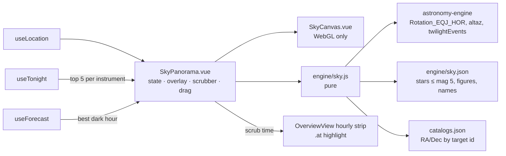

# Sky hero

Branch: `next_level`. Status: draft for review.

## Intent

A portfolio showpiece for frontend / creative-dev reviewers. Success is a live link (`astrodash.mary.codes`) where a
reviewer, on a laptop or phone and most likely in daytime, sees craft within about 30 seconds: a striking first
screen, smooth motion, no jank, and numbers that hold up in devtools. Most reviewers never change the location and
many are outside the US, so the Big Bend demo with zero input *is* the experience. Depth in one centerpiece beats
breadth. A relief-lit Moon for the lunar view is agreed as later polish in its own spec.

## Outcome

1. The site is deployed to GitHub Pages at `astrodash.mary.codes` (Phase 6 of `CLIENT_SIDE_PLAN.md`).
2. The home page opens with a full-width **sky hero tile** above the existing bento: a WebGL horizon panorama of
   tonight's sky for the current location, showing
   - a twilight sky driven by the real Sun altitude, with a terrain silhouette;
   - stars to magnitude 5, constellation lines and constellation names;
   - the planets and a phase-correct Moon;
   - a ring on each of the top 5 targets per instrument (deduplicated, so up to 10 rings).
3. A sunset→sunrise **scrubber** moves the sky through the night and highlights the matching chip in the hourly strip.
4. In daytime the tile plays a short **intro**: time runs from sunset to tonight's best dark hour while the camera
   turns from the sunset glow to the #1 target. At night it opens at the current time.
5. A README case study (GIF, pitch, architecture, decisions, credits) and a Lighthouse / accessibility polish pass.

## Non-goals

- Milky Way texture, alt/az grid, ecliptic, star twinkle, star names.
- Real horizon profiles (the silhouette is decorative, not the site's true horizon).
- Re-ranking targets on scrub (the top-targets tile keeps its whole-night ranking).
- More than the top 5 targets per instrument; daytime sky rendering (the scrubber starts at sunset).
- The relief-lit Moon (separate spec), any new dependency, three.js.

## Decisions

| Question | Choice | Why |
|---|---|---|
| Placement | Hero tile at the top of the bento | Sky and dashboard both above the fold; the canvas stays a contained element (a full-page background would be hidden by tiles and costly to blur every frame) |
| Projection | Stereographic camera with yaw and pitch | Targets are scored by peak altitude and often culminate above 55°; a cylindrical strip at this tile's 2.6 : 1 shape cuts off the sky at ~55–70°. Stereographic is conformal and can tilt to the zenith; the horizon bends gently like a wide-angle lens |
| Layers | Base + constellation lines and names + top 5 per instrument | Agreed scope |
| On load | Daytime intro to the best moment; at night, now | A daytime "now" is a starless blue sky |
| Scrub scope | Sky + hourly-strip highlight | Ties forecast to sky at almost no cost |
| Drag | GSAP `Draggable` + `InertiaPlugin` | Already installed (gsap 3.15 includes both) |

## Design

### `src/engine/sky.js` (pure, no DOM)

- `skyAt(location, date)` → `{ rot, sun, moon, planets }`. `rot` is the 3×3 J2000→horizon matrix from
  `Rotation_EQJ_HOR` (precession, nutation and Earth rotation in one call). `sun`, `moon` and the 7 planets come from
  the existing `altaz` (alt/az degrees); `moon` adds illuminated fraction and waxing.
- `nightRange(location, now)` → `{ start, end }`: tonight's sunset and sunrise from `twilightEvents` for the night
  `darkWindow` picks; if either is null (midnight sun, polar night), `darkWindow`'s own start/end.
- `introEnd({ bestHour, twilight, range })` → the start of the best dark hour if known, else astronomical dusk, else the range midpoint.
- `camera({ yaw, pitch, hfov, width, height })` with `project(altAz)` → `{ x, y, visible }` (CSS px) and
  `unproject(x, y)` → alt/az. Stereographic about the view direction; `visible` is false more than ~100° from it.
- `targetVector(id)` → J2000 unit vector from `catalogs.json` (Messier, NGC by `id`, watchlist by `designation`).
  The tonight plan output has no RA/Dec; this lookup avoids changing its shape. Planets and the Moon use `altaz`.
- `topTargets(instruments)` → the first 5 `isDisplayable` targets of each instrument list, deduplicated by `id`, each
  carrying the instruments it came from and its plan `score`. The #1 target is the highest score among them.

### `src/engine/sky.json`

Built once by a scratchpad script (not committed, like `lunar.json`) from d3-celestial's `stars.6.json`,
`constellations.lines.json` and `constellations.json`: stars with mag ≤ 5.0 as `[raHours, decDeg, mag, bv]`,
each constellation's polylines as `[raHours, decDeg]` pairs, and each name with its label point. Three decimals.
Budget: under 30 KB gzip. Source: d3-celestial © 2015 Olaf Frohn, BSD-3-Clause (stars from XHIP, figures from the
IAU); see Credits.

### `src/components/SkyCanvas.vue` (WebGL only)

Props: the current `skyAt` frame, the camera, the location's terrain seed. Emits `failed` when WebGL is missing,
shader setup fails, or the context is lost. Same raw-WebGL style as `MoonMap.vue`; no continuous loop: it redraws
once per change, batched in `requestAnimationFrame`. Device pixel ratio capped at 2; sized by a `ResizeObserver`.

1. **Sky quad.** Each pixel is unprojected to a horizon direction. Colour comes from a palette keyed on the Sun's
   altitude at 0°, −6°, −12° and −18°, plus a twilight arch toward the Sun and a glow toward the Moon scaled by its
   illuminated fraction (when it is up). Below a terrain height of three summed sines (seeded by the rounded
   coordinates, peaks under 3°) the pixel is a near-black silhouette.
2. **Stars** (`gl.POINTS`). The vertex shader applies `rot`, then the camera, then the projection. Point size and alpha
   come from magnitude, colour from B−V. The limiting magnitude rises from 0 to 5 as the Sun goes from −6° to −18°,
   lowered by up to 1 for a bright Moon above the horizon, so stars come out during the intro by themselves. Stars
   below the horizon are discarded.
3. **Constellation lines** (`gl.LINES`), same transform, low alpha scaled by darkness. Each vertex carries its
   partner's vector so a segment with either end out of view is collapsed (no streaks across the screen).

### `src/components/SkyPanorama.vue`

Props: `location`, `tonight`, `forecast`. Emits `time` (epoch ms) and `failed`.

- **Tile:** a `<section>` labelled "Sky over {place} tonight". `aspect-ratio: 2.6 / 1`, `4 / 3` below 700 px, reserved
  before the first draw. A small "credits" link in a corner to
  `https://github.com/captainpainway/astro-dashboard#credits`.
- **Camera:** horizontal field `clamp(width / 7, 90, 180)` degrees; pitch default 25°, range 5–85°; yaw wraps 360°.
  Drag (Draggable on a proxy, inertia flick) turns and tilts. With the sky focused, ←/→ turn 10° and ↑/↓ tilt 5°.
- **Overlay** (absolutely positioned from `camera.project`):
  - target rings: buttons coloured by instrument (a split ring for a target in both lists); hover or focus shows a
    tooltip with name, class, alt/az at the scrub time and best time, using `MoonMap`'s GSAP pop-in; aria-label like
    "Saturn, planet, 42° up, south-east";
  - the Moon as a small SVG disc with its true lit fraction, lit side facing the Sun's on-screen direction;
  - planets as labelled dots; constellation names as faint `aria-hidden` text that fades with darkness;
    compass labels along the horizon;
  - edge markers for targets out of view ("← M31", "↑ M15"), buttons labelled "Turn to M31" that tween the camera
    to centre the target.
- **Scrubber:** a native `<input type="range">` from `nightRange` start to end, 5-minute steps, labelled "time" with
  `aria-valuetext` such as "22:30". Ticks mark now (when inside the range) and the best dark hour (once the forecast
  has loaded; the best hour is the dark hour with the highest score, as `OverviewView`'s `bestWindow`). Every change
  emits `time`.
- **Open logic** (first mount and every location change):
  - if now is inside the range: time = now, camera facing the #1 target (south if no target is up);
  - otherwise the **intro**: after the first draw, GSAP tweens a progress value 0→1 over 4 s (`power2.inOut`).
    Each frame, time = sunset + progress × (`introEnd(...)` − sunset), with the end read each frame so a forecast
    arriving mid-intro retargets it smoothly; yaw goes the short way from the Sun's azimuth at sunset to the #1
    target's azimuth at the end time. Any drag, key press or scrub kills the tween.
  - the #1 target's azimuth, like the end time, is read each frame, so targets arriving mid-intro retarget it; if
    they arrive after the open logic ran and before any user input, the camera turns to the #1 target over 1 s;
  - `prefers-reduced-motion`: no intro (jump to its end state), no inertia, instant camera turns, no tooltip spring.
- **Live region:** a polite status, debounced 500 ms after scrubbing stops: "22:30, 7 of 10 targets above the horizon".
- **Tab order:** scrubber, sky, target rings, edge markers.

### `OverviewView.vue` and `App.vue`

- `App.vue` passes `location` to `OverviewView`, so the sky draws before the tonight plan loads (astronomy needs no
  network).
- `OverviewView` renders `<SkyPanorama>` as the first, full-width bento tile; on `failed` it drops the tile and the
  bento is exactly as today. It keeps the last emitted `time` and adds class `at` to the hourly chip whose hour
  contains it.
- `style.css`: tile, overlay, scrubber and `.hour-chip.at` styles in the existing glass idiom.

### Failure and edge cases

| Case | Behaviour |
|---|---|
| No WebGL, shader failure, or context lost | `failed`; the tile is removed |
| Tonight plan fails or is loading | Sky draws without rings; errors already show in the page's existing messages |
| Forecast fails or is loading | No best-hour tick; the intro ends at astronomical dusk |
| No sunset or sunrise | `nightRange` falls back to `darkWindow`'s window |
| No astronomical dusk (short summer nights) | `introEnd` falls back to the range midpoint |
| A target ID not in the catalogs | That ring is skipped; tested so it cannot happen for the bundled catalogs |
| Location change | The open logic runs again |

### Performance

- Per frame: one `Rotation_EQJ_HOR`, `altaz` for the Sun, Moon and 7 planets, and up to 10 matrix–vector products;
  measured in the browser, target under 2 ms. If it is over, cache body positions per 5-minute step.
- No continuous animation loop; GSAP drives frames only during the intro, inertia and camera tweens.
- Lighthouse (mobile) targets: performance ≥ 90, accessibility ≥ 95, CLS ≈ 0.
- Measure the bundle growth from `Draggable` + `InertiaPlugin` and `sky.json` in the build output; report it.

## Delivery order

1. **Deploy (Phase 6).** Remove the `/api` proxy from `vite.config.js` (`src/api.js` has no server code left); add
   `public/CNAME` (`astrodash.mary.codes`) and `.github/workflows/deploy.yml` (on push to `main`: `npm ci`,
   `npm test`, `npm run build`, upload and deploy to Pages). **Owner steps** (outward-facing, not done by Claude):
   DNS `CNAME astrodash → captainpainway.github.io`, repo Settings → Pages → source "GitHub Actions", and the push.
2. **Sky hero.** `sky.json` → `sky.js` + tests → `SkyCanvas` → `SkyPanorama` → `OverviewView`/`App` wiring + tests →
   browser check.
3. **Polish + README.** Fix what Lighthouse and the accessibility pass find. README: intro GIF, one-paragraph pitch,
   architecture diagram, decisions (no server, client-side ephemeris, hand-written WebGL, no three.js), and Credits:
   NASA JWST background image, NASA SVS CGI Moon Kit, USGS/IAU gazetteer, Astronomical League checklist, NWS,
   Open-Meteo, and d3-celestial with its full BSD-3 notice.

## Risks

- **Projection and frame signs.** A sign error mirrors the sky or puts the Sun's glow on the wrong side. Guarded by
  the Polaris and Sun-altitude tests and the screenshot check.
- **Line culling at the view edge.** The partner-vertex test may still leave short streaks near the cutoff; tune the
  cutoff angle in the browser check.
- **Label clutter** when targets and constellation names overlap near the zenith; names fade first, rings stay.
- **Mobile GPU cost** of the full-screen sky shader at DPR 2; drop to DPR 1.5 on small screens if the frame budget
  fails.
- **Deploy needs owner action**; until DNS and Pages are set, the site is reachable only at the default Pages URL.

## Proof

- `tests/sky.test.js` (new, mirrors `tests/moonview.test.js`):
  - Polaris altitude is within 1° of the site latitude at Big Bend;
  - the Sun's altitude at `twilightEvents(...).sunset` is −0.83° ± 0.2°;
  - the `rot` path agrees with `starAltAz` for M42 at a fixed date within 0.05°;
  - `unproject(project(p))` round-trips; the view direction projects to the tile centre; a point behind is not visible;
  - `targetVector` resolves every non-planet, non-Moon ID in `tests/fixtures/tonight-expected.json`;
  - `topTargets` keeps 5 per instrument and merges `M45` (in both lists) into one entry with both instruments;
  - `introEnd` falls back best hour → astronomical dusk → midpoint; `nightRange` falls back to `darkWindow`.
- `tests/OverviewView.test.js` (extended, `SkyCanvas` stubbed): rings render for the fixture's top targets with
  `M45` once; an out-of-view target gets an edge marker; an emitted `time` adds `at` to the matching hourly chip;
  `failed` removes the tile; with reduced motion the time is set to the intro end without tweening.
- Browser check (Playwright / chrome-devtools): screenshot for a fixed date at Big Bend (Polaris ~29° up in the
  north, Orion or the Big Dipper recognisable); the intro plays; drag and edge markers work; layout at 375 px; a
  Lighthouse mobile audit against the targets above.
- Commands: `npx vitest run tests/sky.test.js tests/OverviewView.test.js`, then `npm test`, then
  `npx vite build --outDir <scratchpad>/dist --emptyOutDir` so no build output lands in the repo.

## Files

New: `src/engine/sky.js`, `src/engine/sky.json`, `src/components/SkyCanvas.vue`, `src/components/SkyPanorama.vue`,
`tests/sky.test.js`, `public/CNAME`, `.github/workflows/deploy.yml`, `README.md`.
Edited: `src/components/OverviewView.vue`, `src/App.vue`, `src/style.css`, `vite.config.js`,
`tests/OverviewView.test.js`.

## Estimate

About 235k tokens: deploy ~25k, `sky.json` + `sky.js` + tests ~45k, `SkyCanvas` ~40k, `SkyPanorama` ~60k, wiring and
component tests ~20k, browser and Lighthouse checks ~30k, README ~15k.
