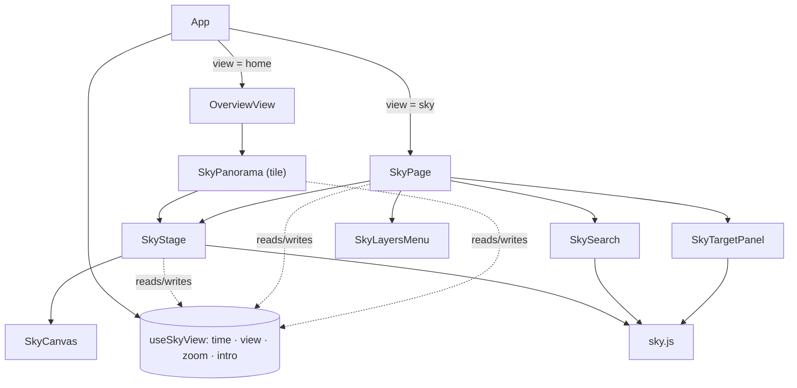

# Sky page

Branch: `next_level`. Status: draft for review. Builds on `2026-10-05-sky-hero-design.md` (Tasks 1–4 done, plus zoom,
two-finger tilt and the credits-link removal).

## Intent

The home tile shows tonight's sky in a strip. The sky page is the same sky with room to explore it: every target in
tonight's plan, search, layers and time controls. It serves two readers. A portfolio reviewer should find it
polished, responsive and accessible. The owner should find it useful on a real observing night: "what's up now, where,
and what should I look at next".

## Outcome

1. A sixth page, **sky**, with its own dock item and with the tile's new corner **expand icon** as a shortcut. Like
   other pages it has `AppHeader` on top; below it, one rounded glass `.panel` fills the rest of the viewport with the
   page's normal side padding (1.5rem).
2. The page and the tile share one **sky state** (time, view direction, zoom). Opening the page from the tile keeps
   what the tile showed, and changes carry back.
3. A **target panel** lists every displayable target in tonight's plan, filterable by instrument and "above horizon";
   the sky rings exactly what the panel shows.
4. **Layers**: constellation lines and names, planets and Moon, targets, star names, deep-sky catalogue, alt/az grid,
   ecliptic, meridian. Toggles persist per browser.
5. **Time controls**: play/pause through the night, ±1 hour, now, best hour.
6. **Search** for targets, catalogue objects, planets, the Moon, constellations and named stars; the view turns to the
   pick and marks it.

## Non-goals

- State in the URL (pages have no URLs today) or Back-button handling.
- Stars fainter than magnitude 5; rise/set times in search; a drag-to-resize phone sheet; device-orientation mode.
- Changes to the home tile beyond the expand icon and the internal extraction.
- The hero plan's Task 5 (README, GIF, `credits.txt`) — it runs after this, so the case study covers the page.

## Decisions

| Topic | Decision | Why |
|---|---|---|
| Navigation | `view === 'sky'`, dock item "sky" after "home"; tile icon calls `setView('sky')` | Same as every other page |
| State | `useSkyView(location)` owned by `App.vue`, passed as a prop | Follows the existing App-owned composable pattern; carries over between tile and page |
| Code split | `SkyStage.vue` holds canvas, overlay and gestures; tile and page wrap it | No second copy of drag/zoom/pinch/intro logic |
| Intro | Plays once per location, wherever the sky first appears | Switching pages must not replay it |
| Targets | All displayable targets, merged across instruments, sorted by best score | The page's job is the whole plan |
| Ring clutter | All rings 24px; rings outside the top 10 by score drawn at 45% opacity until hovered/selected | Shrinking rings would fail the 24px touch-target audit |
| Layout | Desktop: sky + 300px collapsible right column. ≤700px: "Targets (n)" opens a sheet over the lower 60% | Chosen layout; the sheet avoids gesture conflicts |
| Layers storage | `localStorage` key `astrodash.skyLayers`, wrapped in try/catch | A per-viewer convenience; defaults apply when storage fails |
| Star names | `sky.json` gains 216 named stars ≤ mag 3.5 (+3.4 KB gzip, ~26 KB total) | "Vega" must be findable; stays under the 30 KB budget |

## Design



### `src/composables/useSkyView.js` (new)

`useSkyView(location)` returns one reactive object shared by tile and page:

- `time` (epoch ms), `view` `{ yaw, pitch, zoom }`, `range` (`nightRange`), `touched`, `introPlayed`.
- `open({ targets, bestHour })` — today's `SkyPanorama.open()` moved here: at night, now and facing the #1 target;
  in daytime the 4 s intro (only if `!introPlayed`, then sets it), or its end state with reduced motion.
- `face(date, animate)`, `stopMotion()`, `touch()` — moved from `SkyPanorama`.
- Resets (`touched`, `introPlayed`, zoom 1) when `location` changes.

Each stage clamps the shared zoom to its own `zoomMax` when building its camera (it already does: `Math.min(view.zoom,
zoomMax)`).

### `src/components/SkyStage.vue` (new, extracted)

Everything inside today's `.sky-stage`: `SkyCanvas`, overlay (constellation names, compass, planets, Moon, rings, edge
chips, tooltip, hint), gestures (drag, keys, Ctrl/⌘+wheel, pinch, two-finger tilt), and the live status line.

- Props: `sky` (from `useSkyView`), `location`, `targets` (array to ring), `layers` (object, see below; the tile passes
  its fixed defaults), `selectedId` (`v-model:selected-id`), `highlight` (a search pick `{ name, kind, v }` or null),
  `emphasis` (Set of ids drawn at full opacity; null means all).
- Emits: `failed`, `update:selectedId`.
- Exposes: `turnTo(altAz)`.
- Edge-chip and ring rules unchanged (best-score-first overlap hiding, 12px inset).

### `SkyPanorama.vue` (tile, slimmed)

`SkyStage` + scrubber + zoom buttons + new **expand icon** (`<button class="sky-expand" aria-label="Open the full
sky">`, top-right corner of the stage, 24×24 minimum). Emits `expand`; `OverviewView` re-emits it and `App.vue` calls
`setView('sky')`. Still emits `time` for the hourly-chip highlight.

### `src/components/SkyPage.vue` (new)

`AppHeader`, then `.panel.sky-page` laid out as a CSS grid:

```
desktop                                   ≤700px
┌ toolbar: search · layers ──┬ panel ┐   ┌ toolbar: search · layers · Targets (n) ┐
│ SkyStage                   │ list  │   │ SkyStage                                │
├ time row ──────────────────┴───────┤   │ (sheet over lower 60% when open)        │
└────────────────────────────────────┘   ├ time row (two lines)                    ┤
```

- `main.page` gets `page-full` on this view (no `max-width`); the panel fills the remaining height with a flex column
  (`min-height: 420px`), no hard-coded header height.
- Time row: ▶/⏸, −1h, scrubber, +1h, Now, Best, −/+ zoom, time label.
  - Play advances 1 hour per real second (rAF, continuous), stops at sunrise; play at sunrise restarts at sunset;
    scrubbing pauses it. Reduced motion: jumps one hour per second.
  - ±1h snaps to the 5-minute grid and clamps to the night. Now is disabled outside the night. Best is hidden until
    the forecast's best dark hour exists.
- Without WebGL the stage area shows "Your browser can't draw the sky (WebGL is unavailable)."; panel and search still
  work (picks select without turning).

### `src/components/SkyTargetPanel.vue` (new)

- Rows: `allTargets(instruments)` (all displayable, merged by id with `instruments: []`, sorted by best score). Each row:
  instrument swatch(es), name, class, best time, and altitude/compass at the shown time or "below horizon".
- Filters: chips All · 8" Dob · Dwarf Mini; an "above horizon" toggle that follows the scrubber. Emits the filtered
  list; the page passes it to `SkyStage` as `targets`.
- Click a row: select it and `turnTo` it. Hover a row: highlight its ring. Selecting a ring scrolls its row into view.
- Desktop collapse ⟨/⟩; phone sheet with a close button. States: "loading targets…", a one-line error, "No targets
  match these filters".

### `src/components/SkyLayersMenu.vue` (new)

A "Layers" button opening a glass popover of labelled `<input type="checkbox">`s; Esc and outside-click close it.

| Layer key | Default | Drawn by |
|---|---|---|
| `lines` | on | `SkyCanvas` (existing) |
| `names` | on | overlay (existing) |
| `planets` | on | overlay (existing; includes the Moon) |
| `targets` | on | overlay rings |
| `stars` | off | overlay: names of mag ≤ 2 stars; all 216 from 2× zoom |
| `deepSky` | off | overlay: dim markers for 110 Messier + 40 NGC; names from 2× zoom; hover/tap tip with name, type, magnitude |
| `grid` | off | `SkyCanvas`: altitude circles every 15°, azimuth lines every 30° |
| `ecliptic` | off | `SkyCanvas`: one great circle, warm tint |
| `meridian` | off | `SkyCanvas`: north–zenith–south line |

Star-name and deep-sky markers are `aria-hidden` and not focusable (search reaches them).

### `src/components/SkySearch.vue` (new)

- ARIA combobox: input + listbox, ↑/↓, Enter, Esc clears; `/` focuses it from anywhere on the page (not while typing
  in another field).
- Index (`searchIndex()` in `sky.js`, built once): tonight's targets, `catalogs.json` Messier/NGC/watchlist, planets,
  the Moon, `sky.json` constellation names, `sky.json` star names. Each entry `{ name, kind, id?, aliases[] }`.
- Matching (`searchSky(index, query, limit = 8)` in `sky.js`): case-insensitive, spaces ignored for ids ("m 45" =
  "M45"); whole-word prefix matches rank above substring matches; ties by kind (targets first) then name.
- Result row: name, kind, "28° up ENE" or "below horizon" at the shown time.
- Pick: `turnTo` it and set `highlight` (dashed ring + tooltip), even for non-targets. Below the horizon: turn to its
  azimuth at pitch 5 and announce "Vega is below the horizon at 12:00 AM" (status line + hint). Esc or a new search
  clears the highlight.

### `src/engine/sky.js` additions (pure)

- `allTargets(instruments)` — `topTargets` without the per-instrument cut (refactor `topTargets` to share the merge).
- `eclipticLine()`, `gridLines()`, `meridianLine()` — vertex arrays (segments as pairs of unit vectors); ecliptic in
  J2000, grid and meridian in the horizon frame.
- `searchIndex(tonightInstruments)`, `searchSky(index, query, limit)`.
- `playStep(time, range, dtMs, rate)` — next time for play, with stop/wrap rules.

### `SkyCanvas.vue` changes

New prop `layers`. The grid, ecliptic and meridian buffers are built once at setup and drawn with the existing line
program: the ecliptic with `uRot = frame.rot`, grid and meridian with an identity `uRot`, each with its own colour
uniform (`LINE_FRAG` gains `uniform vec3 uColor`). Disabled layers skip their draw call.

### `src/engine/sky.json`

Gains `starNames: [[name, raHours, decDeg, mag]]`. One-off build (scratchpad, not committed), extending the hero
plan's `build-sky.mjs` after downloading `starnames.json` from the same d3-celestial folder:

```js
const starnames = JSON.parse(readFileSync('starnames.json', 'utf8'))
const starNames = load('stars.6.json')
  .filter((f) => f.properties.mag <= 3.5 && starnames[f.id]?.name)
  .map(({ id, properties: { mag }, geometry: { coordinates: [lon, dec] } }) =>
    [starnames[id].name, raHours(lon), r3(dec), r3(mag)])
// writeFileSync(..., JSON.stringify({ stars, lines, names, starNames }))
```

Expected: 216 named stars, `sky.json` ≈ 26 KB gzip.

### `App.vue`, `AppDock.vue`, `OverviewView.vue`

- `AppDock` `ITEMS` gains `{ key: 'sky', label: 'sky', d: 'M3 19h18M12 4l1.5 3.5L17 9l-3.5 1.5L12 14l-1.5-3.5L7 9l3.5-1.5z' }` (a four-point star over a horizon line, stroke-only like the others) after home.
- `App.vue`: `const sky = useSkyView(location)`; `<SkyPage v-else-if="view === 'sky'" …>`; `page-full` class for it;
  `@expand="setView('sky')"` on `OverviewView`; passes `sky` to both.

### Failure and edge cases

- WebGL missing / shader failure / context lost: tile disappears (unchanged); page shows the message, list and search.
- Tonight plan loading or failed: panel states above; sky still draws stars and planets.
- Location change: `useSkyView` resets; search highlight cleared; page re-opens like the tile.
- Unknown target ids: skipped silently (unchanged).
- `localStorage` throws or is empty: default layers.

### Performance

- No continuous loop while idle (unchanged); play uses rAF only while playing.
- New line layers add ~1,500 segments in static buffers; toggles skip draw calls.
- Up to ~120 rings and ~150 deep-sky markers are HTML overlay elements recomputed per frame change; budget is ≤ 2
  frame intervals per scrub step with every layer on.

## Delivery order

1. Extract `SkyStage` + `useSkyView`; the tile is behaviourally identical (existing tests pass unchanged).
2. Page shell: dock item, expand icon, `SkyPage` layout, shared state carry-over.
3. Target panel, filters, ring emphasis.
4. Time controls.
5. Layers, including `starNames` in `sky.json`.
6. Search.
7. Browser verification and Lighthouse.

Each phase is a commit with its tests green. Then the hero plan's Task 5.

## Risks

- **Extraction regressions** in the tile: mitigated by keeping every existing tile test unchanged in phase 1.
- **Overlay cost** with ~270 HTML markers: measured in phase 7; fallback is drawing deep-sky markers in WebGL.
- **Phone sheet vs gestures**: the sheet sits outside `.sky-stage`, so drag/pinch don't reach it; verified on an
  emulated phone, and needs a real-device check by the owner.
- **Ring clutter** at 120 targets: opacity emphasis plus filters; revisit if screenshots look busy.

## Proof

- `npx vitest run` green, with new tests in `tests/sky.test.js`, `tests/OverviewView.test.js`, `tests/App.test.js` and
  a new `tests/SkyPage.test.js` (no existing test covers this page).
- Browser (Playwright, fixed clock, artifacts in the scratchpad): desktop and 375px layouts with no horizontal scroll;
  the phone sheet; carry-over from tile to page; frame budget with all layers on; search to a below-horizon star.
- Lighthouse accessibility ≥ 95 on the sky page; `sky.json` < 30 KB gzip; bundle growth recorded.

## Files

New: `src/composables/useSkyView.js`, `src/components/SkyStage.vue`, `SkyPage.vue`, `SkyTargetPanel.vue`,
`SkyLayersMenu.vue`, `SkySearch.vue`, `tests/SkyPage.test.js`.
Changed: `src/components/SkyPanorama.vue`, `SkyCanvas.vue`, `OverviewView.vue`, `AppDock.vue`, `src/App.vue`,
`src/engine/sky.js`, `src/engine/sky.json`, `src/style.css`, `tests/sky.test.js`, `tests/OverviewView.test.js`,
`tests/App.test.js`.

## Estimate

About 300k tokens to implement: extraction ~40k, shell ~30k, panel ~50k, time ~30k, layers ~60k, search ~50k,
verification ~40k.
